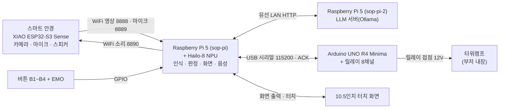

# 프로젝트 최종 정리 — SOP 가디언

> **이 문서는** 프로젝트의 **최종 결과**를 사람이 읽기 좋게 한 곳에 모은 정리본이다. 대상은 최종 기능 · 시스템 · 설정값 · 학습 · 모델 · 측정 방법 · 수치다. 보고서 · 발표 · 포트폴리오 등에 옮겨 쓰는 출발점으로 쓴다.
>
> - **기준 시점**
>   - 날짜: 2026-10-12
>   - 문서: sop-project `8ffa018` 다음 커밋
>   - 시연 프로그램: Rpi5 `bfba16f`
> - 🔴 **정본이 아니다.** 통합문서 · 성능검증 저널 · 설계 문서 · 코드 · 학습 기록에서 옮긴 사본이다.
>   - 어긋나면 **[`통합문서.md`](통합문서.md) 가 이긴다.**
>   - 발표 자료는 근거로 쓰지 않았다.
> - **넣은 것**
>   - 지금 시연 프로그램에서 실제로 켜져 있는 기능
>   - 코드의 실제 값
>   - **지금 구성**(학교 실콘솔 · XGA · 지금 시연 모델)에서 잰 수치
>   - **목표에 못 미친 값.** 미달도 최종 결과라서 넣었다.
> - **뺀 것**
>   - 미확정 · 중단 · 향후 과제(→ 통합문서 §12 🔓 미결 표 · §10)
>   - 개발 과정의 이력(단, 10장의 결정 근거와 11장의 문제 해결 사례는 남겼다)
>   - **옛 구성의 값**(모조 콘솔 · 옛 모델 `console_v2` · `tool_v1~v4` 시절 수치)
>   - 실물에서 다시 재지 않은 음성 즉답의 성능 수치(기능이 켜져 있다는 사실은 5.6 에 적었다)
> - 「기록 없음」은 원본 어디에도 값이 남아 있지 않다는 뜻이다.

### 수치를 옮겨 쓸 때 지킬 것

1. **조건을 같은 줄에 같이 적는다.** 모든 결과는 「장소1 · 1인」 조건이다. 다른 사람 · 다른 장소에서는 재지 않았다.
2. **통합값만 쓴다.** 세션 하나의 값을 대표값으로 쓰지 않는다.
3. **「검증 완료」로 단정하지 않는다.** 「장소1 · 1인 조건에서 목표 충족」처럼 쓴다.
4. **지표 이름을 섞지 않는다.** 사전 차단율 · 사전 감지율 · 선행시간은 서로 다른 것을 잰다(9장).

### 목차

| 장 | 이 장에서 답을 찾는 질문 |
|---|---|
| 1 | 한마디로 무엇이고 결과는 어땠나? |
| 2 | 무엇을 왜 만들었고 무엇이 다른가? |
| 3 | 시연에서 작업자는 무엇을 하나? |
| 4 | 시스템은 무엇으로 어떻게 이루어졌나? |
| 5 | 시스템은 무엇을 하나? |
| 6 | 시연 때 실제로 쓰는 설정값은 무엇이고 왜 그 값인가? |
| 7 | 모델은 어떤 데이터로 어떻게 학습하고 변환했나? |
| 8 | 측정은 어떤 환경에서 어떤 절차로 했나? |
| 9 | 최종 수치는 얼마인가? |
| 10 | 주요 설계는 무엇과 비교해 왜 그렇게 정했나? |
| 11 | 어떤 문제를 어떻게 풀었나? |
| 12 | 최종 상태에 어떤 한계가 있나? |
| 13 | 시험 · 기록 · 도구는 무엇이 있나? |
| 14 | 어떤 오픈소스를 어떤 라이선스로 썼나? |
| 15 | 각 내용의 근거는 어디 있나? |

---

## 1. 한눈에 보기

반도체 장비 PECVD(Plasma-Enhanced Chemical Vapor Deposition · 플라스마 화학기상증착) 정비 중 작업자가 **정해진 순서와 다른 버튼을 누르려 할 때**, 시스템이 다음과 같이 동작한다.

- 작업자가 쓴 안경 카메라 영상만으로 위반을 **누르기 직전에 알아채 경고**한다.
- 그래도 누르면 **차단**한다(적색 램프 · 부저 · 버튼 입력 무시. 버튼 전기 신호를 릴레이로 끊는 부분은 실물 미동작 — 5.3).
- 모든 판단은 현장의 소형 컴퓨터(라즈베리파이 5 + AI(Artificial Intelligence · 인공지능) 가속기 Hailo-8)에서 한다. 영상을 외부로 보내지 않는다.

**최종 결과** — 조건: 장소1(학교 실콘솔) · 1인 · 2026-10-12 · 판정 기준 안 B

| 항목 | 결과 | 목표 | 판정 |
|---|---|---|---|
| 위반 사전 차단율 | **88.5%**(54/61) | 80% | 충족 |
| 정상 작업 완주율 | **100%**(10판, 헛경고 0회) | 90% | 충족 |
| 실시간 처리 | **17.0 fps(frames per second · 초당 장 수)**(중앙값) | 15 fps | 충족 |
| 판정 → 인터락 응답 | **최대 16.8 ms**(143건) | 100 ms | 충족 |
| 틀린 공구 통과 | **0건**(20회) | 0건 | 충족 |
| 경고 선행시간 | **0.097초** | 0.25초 | 미달 — 구조적 한계 |
| 음성 알림 지연 | **0.835초** | 0.3초 | 미달 — 안경이 알림 소리를 다 받은 뒤 재생하는 구조 탓(옛 목소리 kss 로 잰 값 · 8.7) |

학습에 쓰지 않은 장소2 사진(장소1 과 같은 방 · 대부분 더 밝음 · 하루 · 194장)으로 시연 모델을 채점한 결과는 다음과 같다.
- 버튼 검출: 재현율 **0.978** · 정밀도 0.985
- 공구 검출: 재현율 **0.678** · 정밀도 0.931

---

## 2. 개요

### 2.1 프로젝트 정보

| 항목 | 내용 |
|---|---|
| 프로젝트명 | Vision AI 기반 웨어러블 연동 작업자 Human Error 사전 예방 안전 시스템 (작업 이름 「SOP(Standard Operating Procedure · 표준작업절차서) 가디언」) |
| 한 줄 정의 | 웨어러블 1인칭 비전 AI로 반도체 장비 정비의 작업 순서 위반을 버튼 입력 직전에 감지·경고하는 휴먼 에러 사전 예방 시스템 |
| 키워드 | #VisionAI · #EdgeAI · #Wearable · #FSM · #HumanError |
| 수행 | 교내 캡스톤(융합프로젝트) 2026.02~10 · 한이음 드림업 2026.04.01~10.30(주최 과학기술정보통신부 · 주관 한국정보산업연합회) |
| 인원 | 총 9명(한이음 멘티 5 · 그 외 참여 4) · 멘토 1 · 지도교수 1 |
| 핵심 | **비전 AI로 정비 순서 위반을 감지·차단하는 것**이 핵심이고, 안전은 그 효과다. |
| 시연 전제 | 콘솔은 시연용 모조품이다. 시연 시나리오는 PECVD 정비로 가정한다. |

**설계 원칙 세 가지**
1. 버튼을 누르기 직전에 순서 위반을 막는다.
2. 1인칭 카메라 한 대로 판정한다.
3. 엣지(현장 장치)에서만 돌린다. 영상을 클라우드로 보내지 않는다.

### 2.2 왜 필요한가

- **인터락이 비는 구간이 있다.** 반도체 장비의 위험 구역은 인터락(조건이 맞지 않으면 동작을 막는 장치)이 지킨다. 그러나 정비 중에는 접근을 위해 인터락을 **일부러 해제하는 것이 허용**된다(SEMI S2 — SEMI = Semiconductor Equipment and Materials International · 반도체 장비 안전 지침).
- **그동안은 관리적 통제뿐이다.** 해제된 동안 작업자를 지키는 것은 절차서 · 교육 같은 관리적 통제다.
- **정비 작업이 위험하다.** 제조업 끼임 사망사고의 약 54%가 수리 · 정비 · 청소 같은 비정형 작업 중에 났다. 피폭 사고 같은 정비 중 사고 사례도 있다.
- **관리적 통제는 사람에게 기댄다.** 사람이 꾸준히 주의를 기울여야 하고(NIOSH — National Institute for Occupational Safety and Health · 미국 국립산업안전보건연구원), 정비에서는 단계를 빠뜨리는 누락 오류가 흔하다(항공 정비 연구).
- **확인 장치가 없다.** 정비 중 조작 순서가 맞는지 확인해 주는 장치는 없다.

→ 그래서 **조작 직전에 경고하고, 강행하면 입력을 막는 한 겹**이 필요하다.

### 2.3 무엇이 다른가

- **대상이 장비 상태가 아니라 사람의 작업 순서다.** 실수 방지 장치(포카요케)의 순서 확인 · 경고 방식을 정비 작업에 옮겼다.
- **겨냥하는 구간**은 인터락 해제가 허용되는 정비 구간이다.
- **작업자 본인 시점(1인칭)으로 보고, 작업자 본인에게 알린다.** 설치형 카메라가 아니라 안경 카메라 한 대로 판정한다.
- **기존 안전장치를 대체하지 않고 그 위에 한 겹을 더한다.**
- **기술 특징**
  1. 인식(AI 모델)과 판정(상태 기계)을 분리했다.
  2. 장치 안에서만 추론해 영상이 밖으로 나가지 않는다.
  3. 데이터셋을 직접 구축했다.
- **선행 사례 조사 결과**
  - 조사 범위: 학계의 1인칭 절차 오류 연구(EgoProceL · IndustReal · EgoPER · TI-PREGO), 상용 설치형 카메라 작업 단계 감시, 비전 검사 + PLC(Programmable Logic Controller · 산업용 제어기) 차단, 스마트글라스 작업 지원.
  - 이 범위에서 1인칭 판정 · 순서 경고 · 조작 차단 · 웨어러블 네 요소를 정비에 함께 적용한 사례는 찾지 못했다(없다는 증명은 아니다).

### 2.4 기능 요구사항(FR · Functional Requirement)과 최종 상태

| ID | 요구사항 | 하는 일 | 최종 상태 |
|---|---|---|---|
| FR-1 | 순서 위반 감지 | 기대 단계가 아닌 버튼에 손이 들어와 머물면(또는 느리게 다가가면) 위반으로 본다 | ✅ 동작 · 측정(9.1) |
| FR-2 | 시청각 피드백 | 경고 = 화면 팝업 + 황색 램프. 차단 = 적색 램프 + 부저 | ✅ 동작 · 부저는 시연 때 연결 |
| FR-3 | 인터락 차단 | 오답을 강행하면 입력을 막는다 | 🔄 부분 — 램프 · 부저 · 소프트웨어 입력 무시로 동작. 버튼 전기 신호를 릴레이(CH5 — Channel 5 · 릴레이 5번 채널)로 끊는 부분은 실물 미동작(우회 배선) |
| FR-4 | 작업자 본인 해제 | 경고 · 차단을 작업자가 화면에서 직접 푼다 | ✅ 동작 |
| FR-5 | 공구 지참 확인 | 요구 공구를 쥐어야 다음 단계로 넘어간다 | 🔄 부분 — 기능 동작 · 틀린 공구 통과 0건(9.1) · 공구 검출 재현율 0.678(장소2 · 9.3) |
| FR-6 | 비상정지 | EMO(Emergency Off · 비상정지) 를 누르면 즉시 차단 | ✅ 동작 |
| FR-7 | 음성 안내 | 호출어로 부르면 지금 할 일을 말로 답한다 | 🔄 부분 — 동작 · 측정(9.4) · LLM 관문 일부 미실시 · 알림 지연 미달(9.1) |

---

## 3. 시연 시나리오

### 3.1 4단계 공정

정답 순서의 단일 출처는 `Rpi5/Demo/recipe.json` 이다.

| 단계 | 버튼 | 단계 이름 | 버튼 뒤 서브 작업 |
|---|---|---|---|
| 1 | B1 노랑 | 클린·가스차단 | 「플라즈마 클린 진행」 10초 대기 |
| 2 | B2 흰색 | 펌프/퍼지 | 「N2 퍼지」 10초 대기 + **렌치를 손에 쥐어야** 진행(공구 후보 = 드라이버 · 렌치 · 플라이어) |
| 3 | B3 핑크 | 전극 냉각 | 「전극 온도 하강」 10초 대기 |
| 4 | B4 검정(파랑 원 스티커) | 챔버 벤트 | 없음 — 누르면 작업 완료 |
| — | EMO(비상정지, 적색) | 어느 때든 누르면 즉시 차단 | 해제하면 처음(작업 시작 전)으로 |

- **서브 작업:** 「버튼 누름 + 대기」가 합쳐져야 한 작업이다.
  - 끝나기 전에 다른 버튼을 누르면 순서 위반이다.
  - 조건이 채워지면 자동으로 다음 단계로 넘어간다.
  - 대기 시간은 단조 시계(시스템 시각 변경에 흔들리지 않는 시계)로 잰다.
- **판정 규칙은 하나다.** 기대 단계가 N 이면 BN 이 정답이고 나머지 공정 버튼은 오답이다.
  - 이 규칙 하나로 단계 누락과 역순이 함께 잡힌다.
  - 오답은 단계를 진전시키지 않는다. 차단을 풀어도 기대 단계는 그대로다.
- **흐름**
  - 정상: 작업 시작 → 단계별 정답 누름 → 서브 작업 → 자동 진행 → B4 완료 → 결과창
  - 이상: 오답 구역 진입 → 경고 → 손을 떼고 해제(또는 정답 누름) → 계속. 오답을 강행하면 차단 → 해제 → 같은 단계 다시.

### 3.2 버튼 배치(실콘솔 포맥스판 · 2026-08-06 제작)

```
   [B2 흰]   [B3 핑크]        ② → ③
   [B1 노랑] [B4 파랑]        ①    ④   (누르는 순서 = 반시계 U 자)
        [EMO 적]
```

버튼의 물리 배치 순서와 작업 순서는 다르다. 작업 순서는 B1 → B2 → B3 → B4 다.

---

## 4. 시스템 구성

### 4.1 블록도



### 4.2 통신 경로

| 구간 | 방식 | 오가는 것 |
|---|---|---|
| 안경 → 파이 | WiFi · TCP(Transmission Control Protocol) 8888 | 영상. 한 장 = 길이 4바이트(`uint32`) + JPEG(Joint Photographic Experts Group · 손실 압축 사진 형식) 본문 |
| 안경 → 파이 | WiFi · TCP 8889 | 마이크 소리. 16 kHz · 16비트 · 모노 · 512샘플씩 · 헤더 없음 |
| 파이 → 안경 | WiFi · TCP 8890 | 소리 재생. `W <샘플수> <레이트>` + 본문 + 체크섬 + `P`. 명령 `S`(중단) · `B`(띠링) · `C`(닫힘음) |
| 무선 경로 | 안경 → 무선 1홉 → 공유기 → 유선 → 파이 | 휴대폰 핫스팟이 아니라 공유기를 거친다(11장 사례 2) |
| 파이 ↔ 아두이노 | USB(Universal Serial Bus) 시리얼 115200 · 양방향 | `RUN` · `WARN` · `BLOCK`(줄바꿈으로 끝남) → 아두이노가 매번 `ACK` |
| 아두이노 → 타워램프 | 릴레이 접점 12V | 녹 · 황 · 적 램프 · 부저 |
| 파이 ↔ 터치 화면 | 화면 출력 · 터치 입력 | 작업 화면 · 해제 버튼 |
| 버튼 → 파이 | GPIO(General-Purpose Input/Output · 범용 입출력) 디지털 입력 | B1~B4 = BCM(Broadcom 칩 기준 핀 번호) 5 · 6 · 13 · 19(눌리면 LOW) · EMO = BCM 26(NC · Normally Closed 평소 닫힘 · 비상이면 HIGH) |
| 파이 ↔ sop-pi-2 | 유선 LAN(Local Area Network · 근거리 통신망) · HTTP(HyperText Transfer Protocol) | 질문 · LLM(Large Language Model · 대형 언어 모델) 답(`192.168.1.12:11434`) |

### 4.3 하드웨어

| 구분 | 사양 |
|---|---|
| 메인 컴퓨터 | Raspberry Pi 5 (8GB) — Cortex-A76 2.4GHz 4코어 · microSD 64GB |
| AI 가속기(NPU · Neural Processing Unit · 신경망 처리 장치) | Hailo-8 (26 TOPS(Tera Operations Per Second · 초당 조 단위 연산) · INT8(8-bit Integer · 8비트 정수)) — 위더스 ZAIV-M.2 · M.2 PCIe(Peripheral Component Interconnect Express) Gen3 |
| 스마트 안경 | XIAO ESP32-S3 Sense <br>· OV3660 카메라 · 내장 PDM(Pulse-Density Modulation · 펄스 밀도 변조) 마이크 <br>· 리튬폴리머 450mAh · U.FL 외장 안테나 <br>· 3D 모델링 + 3D 프린팅 외장 |
| 안경 소리 | 앰프 DFR0954(MAX98357A) · 소형 스피커 |
| 음성 LLM 서버 | Raspberry Pi 5 8GB(sop-pi-2) — LLM 전담 · 비전 없음 |
| 인터락 제어 | Arduino UNO R4 Minima(예비 R3) + 릴레이 8채널(칩 JQC-3FF-S-Z · 코일 71.4 mA · LOW 에서 켜짐) |
| 경보 장치 | 큐라이트 타워램프 ST45L-BZ-3-12 (부저 내장) |
| 터치 화면 | 제우스 Z10 10.5인치 터치모니터 |
| 입력 버튼 | 아케이드 버튼 4개(B1~B4) + 비상정지 KGE-Y4R1R(1a1b · NC) = 총 5개 |
| 전원 | 스위치형 멀티탭(강원전자 NM-SF630)이 콘솔 전체 마스터 · 파이 27W USB-C · 12V 2A 어댑터 |
| 외장 | 알루미늄 프로파일(DF3030) + MDF(Medium Density Fiberboard · 중밀도 섬유판) / 포맥스 |

### 4.4 결선 · 전원

**아두이노 → 릴레이 채널**

| 아두이노 핀 | 릴레이 | 부하 | 켜지는 때 |
|---|---|---|---|
| D7 | CH1 | 적색 램프 | 차단 |
| D6 | CH2 | 황색 램프 | 경고 |
| D5 | CH3 | 녹색 램프 | 정상 |
| D4 | CH4 | 부저 | 차단 |
| D3 | CH5 | B1~B4 공통 GND(Ground · 접지) 한 가닥 차단(EMO 는 거치지 않음) | 차단 — **실물은 우회 배선**(5.3) |

**전원 계통**
- AC(Alternating Current · 교류) 220V → 멀티탭(마스터)에서 두 갈래로 나뉜다.
  - 파이 27W USB-C → 파이 → USB → 아두이노 → 5V → 릴레이 코일
  - 12V 2A 어댑터 → 램프 · 팬 · 접점 부하
- 타워램프: 12V(+)는 공통선, 12V(−)는 릴레이 COM(Common · 공통 단자) 에 연결한다. 각 램프 · 부저 선은 CH1~CH4 의 NO(Normally Open · 평소 열림) 접점에 연결한다.
- 시스템 팬 4개는 12V 에 직결해 늘 켜져 있다.

**안경 전원:** 리튬폴리머 450mAh → 충전 모듈 → 슬라이드 스위치 → XIAO 5V. 앰프 전원은 배터리 마디에서 뽑는다.

### 4.5 안경 펌웨어(ESP32-S3 · `Rpi5/arduino/glass_voice/glass_voice.ino`)

| 항목 | 설정 |
|---|---|
| 빌드 | ESP32 Arduino core 3.3.10 · ESP-IDF(Espressif IoT Development Framework) 5.5.4 · arduino-cli 1.4.1 · 보드 `XIAO_ESP32S3` · PSRAM(Pseudo-Static RAM · 외장 메모리)=opi(필수) |
| 카메라 | CPU(Central Processing Unit · 중앙 처리 장치) 240 MHz · XCLK(External Clock · 카메라 기준 클록) 20 MHz · XGA(eXtended Graphics Array) 1024×768 JPEG · `jpeg_quality=15` · 프레임 버퍼 2장(PSRAM) · 최신 장만 가져오기 |
| 노출 | 부팅 때 노출 상한을 레지스터 `0x3A0E`=2 로 걸어 **약 9.02 ms**(공장값 36.06 ms) |
| 영상 전송 | TCP 8888 · 접속 1개(새 접속이 오면 이전 접속을 교체) · 지연 없이 바로 보냄(TCP_NODELAY) |
| 작업 분담 | 찍기(코어 0) · 보내기(코어 1) · 접속 받기(코어 1) 태스크로 나눔 · 프레임 큐 2 |
| WiFi | 절전 끔(`WiFi.setSleep(false)`). 스캔에 잡힌 등록 SSID 가운데 우선순위가 가장 높은 하나에 접속한다. 실패하거나 하나도 없으면 저장된 자격증명을 쓰고, 그것도 실패하면 5초 뒤 다시 스캔한다. |
| 마이크 | 온보드 PDM · 16 kHz · 16비트 · 모노 · TCP 8889 로 늘 보냄(접속자가 있을 때만) |
| 스피커 | I2S(Inter-IC Sound · 칩 간 디지털 오디오 전송 방식) · 레이트 8,000~24,000 Hz · 최대 10초(240,000샘플) · 음량 정규화(5단계 중 파이는 2단계 = 진폭 4000 사용) · 끝나면 `[재생 완료]` 회신 |
| 보드 | 메인 1장 + 같은 펌웨어의 예비 1장 |

### 4.6 아두이노 펌웨어(`Rpi5/arduino/console_interlock/console_interlock.ino`)

- **명령:** `RUN` · `WARN` · `BLOCK` 을 받을 때마다 `ACK` 를 회신한다.
  - 모르는 명령은 상태를 바꾸지 않고 ACK(Acknowledgement · 수신 확인 회신) 만 보낸다.
  - 15자를 넘는 입력은 버린다.

  | 명령 | 동작 |
  |---|---|
  | RUN | 녹색만 |
  | WARN | 황색(전기는 끊지 않음) |
  | BLOCK | 적색 + 부저 + 차단 채널 |

- **릴레이 논리:** LOW 에서 켜진다. 부팅 때 출력값을 먼저 정한 뒤 출력으로 바꿔, 켜지는 순간의 오동작을 줄인다. 처음 상태는 녹색 · 버튼 통전이다.
- **안전 설계**
  - 시리얼 데이터만 끊기면 마지막 상태를 유지한다.
  - EMO 는 아두이노를 거치지 않고 파이 GPIO 로 바로 간다.

### 4.7 소프트웨어 구조

**프로세스**
- 바탕화면 「시연」 = `run_demo.sh` 를 실행하면 두 프로세스가 뜬다.
- ① **시연 프로그램** `main.py`
  - 시스템 Python 3.13
  - 처리 설정 4(`SOP_INFER_MODEL=1`)를 켠다.
- ② **음성비서** `run_voice.sh --forever`
  - 별도 가상환경 `~/env/tts/.venv` 에서 돈다.
  - 죽으면 3초 뒤 다시 띄운다. 30초 안에 또 죽으면 간격을 두 배씩 늘린다(최대 60초).
- LLM 은 별도 기기 sop-pi-2 의 Ollama 가 맡는다.

**스레드(동시에 도는 작업 흐름)**
- 시연 프로그램
  - 화면(Qt 메인)
  - 카메라 처리 루프
  - 연결마다 수신 전용 스레드(최신 장만 남기고 덮어씀)
  - 인터락 쓰기 · 재연결
  - 측정 기록 쓰기
- 음성비서
  - 메인(말소리 구간 찾기 · 받아쓰기)
  - 마이크 수신
  - 알림 감시 · 재생
  - 안내 소리 감시
  - LLM 호출 · 예열

**데이터 흐름(한 장의 영상이 판정까지 가는 길)**

```
안경 TCP 8888 → 수신 스레드 → JPEG 풀기 → 반전·왜곡보정·회전(한 번의 remap)
→ 버튼 검출(HEF) → 상자 확정(2장 연속) → 손 검출(HEF) → 손끝-버튼 구역 판정
→ 판정기(FSM) → 인터락 명령 · 화면 · 상태 공개 → 아두이노 · 타워램프 · 음성 알림
```

**프로세스끼리 주고받는 방법**

| 경로 | 방식 |
|---|---|
| 시연 → 음성(작업 상태) | `/dev/shm/sop_state/state.json` — 임시 파일에 쓴 뒤 바꿔치기(원자적 교체) · pid · 쓴 시각 첨부 |
| 시연 → 음성(공구) | `/dev/shm/sop_tool/resp.json` · 3초 지나면 낡은 값으로 본다 |
| 진행 도우미 ↔ 음성 | `/dev/shm/sop_cue/` 의 요청 · 응답 파일 |
| 안경 주소 | `Rpi5/Demo/.camera_ip` 하나(시연 · 음성이 함께 읽음) |
| 중복 실행 방지 | `/tmp/sop_voice_assistant.lock` |

**모듈(파일)별 역할 — `Rpi5/Demo/`**

| 갈래 | 파일 · 역할 |
|---|---|
| 시작 · 설정 | `main.py` 앱 시작 · 전체 화면 / `config.py` 전역 설정(613줄) / `recipe.py` · `recipe.json` 정답 순서 |
| 화면 | `safety_console.py` 메인 화면(판정기 · 인터락 · GPIO · 오버레이 묶음) / `overlay.py` 영상 위 패널(상태 · 게이지 · 경고 · 연결) / `overlay_menu.py` 메뉴 · 설정 · 점검 / `overlay_result.py` 결과창 / `theme.py` 색 / `anim.py` 애니메이션 |
| 영상 · 인식 | `camera_thread.py` 수신 → 보정 → 검출 → 손 → 구역 판정 / `frame_orient.py` 반전 · 보정 · 회전 / `detector.py` 추론 백엔드 / `hailo_device.py` NPU 공유 / `hailo_infer.py` 처리 2a 경로 / `hand_tracker.py` 손끝 좌표 / `roi_zones.py` 링 · 안쪽 판정 / `fps.py` 실측 FPS |
| 판정 · 작업 | `fsm.py` 순서 위반 상태 기계(6상태) / `sub_task.py` 서브 작업 / `tool_gate.py` 공구 추론 접점 / `tool_state.py` 공구 쥠 판정 / `session_stats.py` 결과 집계 |
| 제어 · 입력 | `interlock.py` 아두이노 명령 · ACK / `serial_ports.py` 장치 자동 찾기 / `gpio_input.py` 버튼 입력 / `precheck.py` 기동 · 작업 시작 점검 |
| 음성 | `voice_assistant.py` 음성비서 / `voice_mic.py` 마이크 수신 / `voice_lib.py` 호출어 · 말소리 구간 / `voice_card.py` 사실 카드 · 답 다듬기 · 알림 문장 / `voice_llm.py` LLM 호출 / `voice_tts.py` 목소리 합성 / `state_publisher.py` 상태 공개 |
| 기록 | `measure_log.py` · `measure_session.py` · `measure_script.py` · `measure_guide.py` · `measure_prompt.py` 측정 기록 · 진행 도우미 / `raw_recorder.py` · `demo_recorder.py` 녹화 |

### 4.8 개발 · 운영 환경

| 구분 | 내용 |
|---|---|
| 파이 OS(Operating System · 운영체제) | Raspberry Pi OS 64-bit(Debian 13 trixie) · 커널 6.18 |
| Python | 시스템 3.13.5(화면 · 비전) · `~/env/tts/.venv` 3.13(받아쓰기 · 목소리) · `~/env/rfenv` 3.12.13(Ultralytics 8.4.117 · PyTorch 2.13.0+cpu) |
| 주요 라이브러리 | HailoRT 4.23.0 · PyQt6 6.11.0 · OpenCV 4.10.0 · NumPy 2.2.4 · pySerial 3.5 · gpiozero 2.0.1 · sherpa-onnx 1.13.7 · supertonic 1.3.1 · onnxruntime 1.31.0 · Ollama 0.32.13(sop-pi-2) |
| 학습 환경 | 데스크톱 WSL2(Windows Subsystem for Linux 2) Ubuntu 24.04.4 · RTX 5060 8GB · ultralytics 8.4.171 · torch 2.12.1+cu130 · CUDA(Compute Unified Device Architecture · NVIDIA 그래픽 처리 장치 연산 플랫폼) 13.0 · albumentations 2.0.8 · Optuna 4.9.0. 파이에서 `ssh wsl-train` 으로 원격 실행 |
| 변환 환경 | Hailo DFC(Dataflow Compiler · Hailo 모델 변환기) 3.33.1(데스크톱 · Python 3.12 · tensorflow 2.18.0) |
| 라벨링 | X-AnyLabeling |
| 네트워크 | 유선: 파이1 `192.168.1.10` ↔ 파이2 `192.168.1.12` · 안경 `192.168.1.9` · 원격 접속 Tailscale · NoMachine |
| 저장소 | git 저장소 2개 — `sop-project`(문서 · 설계) · `Rpi5`(파이 런타임 코드 · 학습 체계) |

---

## 5. 최종 기능

시연 프로그램을 켜면 아래 기능이 모두 함께 돈다.

### 5.1 인식 — 안경 영상에서 무엇을 보나

- **영상 준비**
  - 안경 카메라의 XGA(1024×768) 영상에 상하반전 → 렌즈 왜곡 보정 → 반시계 90° 회전을 한 번에 적용한다.
  - 결과는 세로 768×1024 다. 안경에 카메라를 옆으로 달았기 때문이다.
- **버튼 검출**
  - YOLOv8n(YOLO = You Only Look Once · 8세대 · n = nano 가장 작은 판) 모델이 버튼 5종(B1~B4 · EMO)의 위치를 상자로 찾는다. NPU 에서 돈다.
  - 새 버튼 상자는 2장 연속 잡혀야 쓴다(한 장짜리 오인식 방지).
  - 가려져도 5장까지는 상자를 유지한다.
- **손 추적**
  - 손바닥 검출 + 손 관절 21점 모델로 **검지 끝** 위치를 얻는다. 구글 MediaPipe 모델을 NPU 용으로 변환했다.
  - 손이 여럿이면 가장 확실한 손 하나만 쓴다.
- **손-버튼 겹침(HOI · Human-Object Interaction — 손과 물체의 상호작용)**
  - 검지 끝이 버튼 상자 안인지 본다.
  - 상자 바깥에 얇은 「접근 테두리(링)」를 두어 두 단계로 나눈다. 링에서는 시간만 재고, **상자 안에서만** 경고한다.
- **공구 검출**
  - 공구 모델(드라이버 · 렌치 · 플라이어)이 공구 단계에서만 약 1초마다 돈다.
  - 공구를 든 동안에는 손-버튼 판정을 잠시 끈다. 실제 버튼 눌림 판정은 그대로다.
- 모델 넷(버튼 · 손바닥 · 손 관절 · 공구)이 NPU 하나를 번갈아(라운드 로빈) 나눠 쓴다.

### 5.2 판정 — 위반을 어떻게 가르나

판정은 **상태 기계(FSM · Finite State Machine — 정해진 상태 사이를 규칙대로 옮겨 다니는 장치)** 가 한다. 화면 · 하드웨어와 분리된 순수 코드다(`fsm.py`).

| 상태 | 뜻 |
|---|---|
| IDLE | 대기(작업 시작 전 · 완료 뒤 · 비상정지 해제 뒤) |
| READY | 다음 단계 준비(머물지 않고 지나감) |
| PROCESS RUN | 작업 진행 |
| MONITOR | 손이 버튼 근처에 들어와 정답 / 오답을 가리는 중 |
| WARNING | 경고 — 틀린 버튼을 누르려 한다 |
| BLOCK | 차단 — 틀린 버튼을 실제로 눌렀다(또는 비상정지) |

**주요 전이**
- IDLE → READY → PROCESS RUN → (손이 들어옴) MONITOR
- 정답 누름 → 다음 단계 READY. 마지막 단계면 IDLE.
- 스치고 지나감 → PROCESS RUN
- 틀린 버튼 상자 안에서 느린 손끝 또는 체류 초과 → WARNING
- 틀린 버튼 누름 → BLOCK
- WARNING 에서
  - 해제 → MONITOR
  - 오답 누름 → BLOCK
  - 정답 누름 → 정상 진행
- BLOCK 해제 → READY. 비상정지로 걸린 BLOCK 이면 IDLE.
- 어느 상태든 EMO → BLOCK

**순서 위반을 막는 두 층**

| 층 | 언제 | 무엇을 하나 |
|---|---|---|
| **1층 사전 경고** | 헷갈려 멈칫하거나 틀린 버튼 위에 손이 머물 때 | **누르기 전에** 경고해 사람이 스스로 멈출 기회를 준다 |
| **2층 차단** | 망설임 없이 곧장 틀린 버튼을 누를 때 | 실제 눌림을 **차단(BLOCK)** 한다 |

곧장 누르는 경우에는 경고가 누르기 약 0.1초 전에야 뜬다. 사람이 반응하기엔 늦다. 이것은 고칠 수 있는 결함이 아니라 **구조적 한계**이고, 그래서 2층(차단)이 막는다.

**경고를 내는 기준(판정 기준 안 B)** — 손끝이 틀린 버튼 상자 안에 있을 때 적용한다.

1. 손끝이 **느리면** 체류를 기다리지 않고 **바로 경고**한다. 기준은 XGA 700 px/s 이하이고, 직전 3장 · 0.25초 안의 손끝으로 잰다. 버튼을 누르려고 감속하는 손을 일찍 잡으려는 규칙이다.
2. 느리지 않으면 **0.3초 넘게 머물 때** 경고한다(체류 규칙). 손이 잠깐 안 보여도 0.3초 안이면 이어서 센다(갭 메우기).
3. **빠르게 0.3초 안에 빠지면 경고하지 않는다**(스침).

경고 대상에서 빼는 것: 정답 버튼 · 방금 끝낸 버튼 · EMO · 공구를 든 손.

### 5.3 제어 · 피드백 — 판정 뒤에 무엇이 일어나나

| 상황 | 타워램프 | 부저 | 화면 | 음성 알림 |
|---|---|---|---|---|
| 정상 진행 | 녹색 | — | 작업 화면 | — |
| 경고(WARNING) | 황색 | — | 가운데 경고 상자 · 서브 작업 게이지 일시정지 | 「순서가 다르니 손을 떼고 Bn 버튼을 누르세요.」 |
| 차단(BLOCK) | 적색 | 울림 | 「⛔ 버튼 입력 차단됨」 상자 · 서브 작업 취소 | 「차단 중이니 차단 해제를 누른 뒤 Bn 버튼부터 다시 누르세요.」 |
| 비상정지(EMO) | 적색 | 울림 | 비상정지 상자 | 「비상정지 중이니 EMO를 복귀한 뒤 차단 해제를 누르세요.」 |

- **경고와 차단은 다른 층이다.** 경고는 전기를 끊지 않는다. 차단은 오답이 실제로 눌린 뒤에만 걸린다.
- **차단의 실제 동작**
  - 차단 중에는 판정기와 화면이 **EMO 를 뺀 모든 버튼 입력을 무시**하고 「차단 중이라 무시」로 기록한다. 그래서 차단 중 눌림이 단계 완료로 인정되지 않는다.
  - 버튼 전기 신호를 릴레이(CH5)로 직접 끊는 부분은 실물에서 동작하지 않아 **우회 배선 상태**다. 그래서 차단은 램프 · 부저 · 소프트웨어 무시로 이루어진다.
  - 화면 문구도 「전기를 끊었다」고 말하지 않는다.
  - 인터락이 연결되지 않은 채 차단되면 「⚠ 인터락 미연결 — 화면에서만 차단 중」이 뜬다.
- **인터락 신뢰성**
  - 모든 명령의 ACK 를 읽는다. 재전송과 알람은 차단 명령에만 둔다.
  - 차단 명령에 응답이 없으면 2번 다시 보내고, 끝내 실패하면 「릴레이 미작동 가능성」 알람을 띄운다.
  - 시리얼이 끊겨도 화면 · 판정은 계속 돈다. USB 신원으로 장치를 다시 찾아 붙고, 붙으면 최신 상태를 다시 보낸다.
- **해제는 작업자 본인이 화면에서 한다.** 해제 버튼 하나로 풀며, 지금 뜬 상자에 따라 돌아가는 곳이 다르다.
  - 경고 해제 → 감시
  - 위반 차단 해제 → 그 단계 다시
  - 비상정지 해제 → 처음(IDLE)
  - EMO 가 복귀하지 않았으면 해제를 거부한다.
- **화면이 보여주는 것**
  - 상태 패널 · 서브 작업 게이지(공구 단계에서는 넓어짐)
  - 공구 「확인 중 n/3」 · 공구 오선택 경고 · 「카메라 미확인」 안내
  - 연결 상태 줄 · 가운데 경고/차단 상자(영상 폭의 46%)
  - ≡ 메뉴: 점검 · 녹화 · 로그 · 설정 · 작업 초기화 · 시스템 종료
  - 영상은 화면 가운데 75% 에 표시한다.
  - 글꼴은 Pretendard 다.
- **작업 완료 결과창**(B4 완료 때 자동)
  - 판정 · 누른 순서 · 단계별 소요 시간 · 순서 위반 · 차단 · 카메라 미확인 · 공구 · 검출 프레임 수를 보여준다.
  - 맨 아래에 「관측치이지 모델 성능이 아니다」를 적는다.
- **운용 조작**
  - ↺ 작업 초기화: 확인창을 거쳐 처음으로 돌아가며, 인터락 해제도 함께 한다.
  - ⏻ 시스템 종료: 파이를 안전하게 종료한다.
- **부저:** 코드는 차단 때 늘 켠다. 측정 · 시험 때는 소음 때문에 선을 빼 두고 **시연 때 연결한다.**
- **키보드 우회(시연 · 점검용 · 늘 켜짐)**
  - `1`~`4` = 버튼(카메라 확인 생략) · `E` = EMO · `T` = 공구 쥠 처리 · `ESC` = 빠져나가기
  - 사용 사실은 로그에 따로 남는다. 대기 시간은 우회되지 않는다.

### 5.4 공구 지참 확인

2단계에서는 10초 대기와 함께 **요구 공구(렌치)를 손에 쥐어야** 다음으로 넘어간다.
- 약 1초마다 검사한다. 검지 끝이 렌치 상자 안이면 1번으로 센다.
- **3번 연속(약 2초)이면 쥔 것으로 확정**한다. 1번 놓침은 봐준다.
- 쥠이 한 번 확정되면 그 서브 작업 동안 유지된다.
- 틀린 공구를 쥐었다가, 손이 보이는데 빈손인 검사가 3번 이어지면(약 3초) 그 공구를 내려놓은 것으로 본다.
- 확정되면 「확인 완료」 상자를 3초 띄운다.
- 다른 공구를 쥐면 「공구 오선택」 경고가 뜬다(해제 버튼 없음 · 맞는 공구를 쥐면 사라짐).

### 5.5 누름 카메라 확인

**정답 버튼**이 GPIO 로 눌렸을 때 **누르기 2.0초 전부터 누른 뒤 0.5초 사이에 손이 그 버튼 구역에서 카메라에 보였는지** 확인한다.
- 보이지 않았으면 단계는 진행한다. 대신 「카메라 미확인」 안내를 4초 띄우고 결과창에 건수를 남긴다.
- 카메라가 끊겨 프레임이 오지 않으면 누른 뒤 2.0초에 그때까지의 기록으로 판정한다.
- 카메라가 판정에서 빠진 채 진행되는 일을 드러내는 장치다.
- 키보드 입력은 확인하지 않는다.

### 5.6 음성비서 「가디언」

손을 쓸 수 없는 작업자가 말로 묻고 듣는다.

**흐름:** 안경 마이크 → WiFi → 파이 → 말소리 구간 찾기(VAD · Voice Activity Detection) → 받아쓰기(STT · Speech-to-Text) → 호출어 「가디언」 확인 → 답 만들기 → 목소리 합성(TTS · Text-to-Speech) → WiFi → 안경 스피커.

| 단계 | 방식 |
|---|---|
| 말소리 구간 찾기(VAD) | 20 ms 마다 소리 크기를 잰다. 주변 소음(조용한 하위 20% 평균)에 맞춰 문턱을 자동으로 정한다. <br>· 시작 문턱 = max(400, 바닥×3.5) · 끝 문턱 = max(200, 바닥×2.0) <br>· 최소 300 ms · 끝 뒤 무음 700 ms · 앞 250 ms 당겨 붙임 · 최대 6초 |
| 받아쓰기(STT) | sherpa-onnx `zipformer-korean-2024-06-24`(int8) · 파이1 스레드 2 · `modified_beam_search` · 핫워드(「가디언」 8.0 · 가스 · 차단 · 펌프 · 퍼지 · 전극 · 냉각 · 챔버 · 벤트 · 공구 등 3.0) · 마이크 ×4 증폭 |
| 호출어 | 받아쓴 문장 **어디에든** 「가디언」(또는 가디 · 카디 · 가지언 · 아디언 조각)이 있으면 부른 것으로 본다. 부르면 「띠링」 뒤 20초 동안 질문을 듣는다. |
| 답 만들기 — 코드가 바로 답함 | 허가를 묻는 질문(「지금 눌러도 돼?」 등) · 장비 센서 질문(가스 · 압력 · 온도 등) · 상태 질문 7종(단계 · 다음 버튼 · 지금 버튼 · 필요 공구 · 보이는 공구 · 상태 · 결과)은 LLM 을 거치지 않고 상태로 한 문장을 답한다. 🔴 상태 질문 즉답은 코드에서 기본으로 켜져 있지만 실물에서 재지 않았다(끄기 = `SOP_VOICE_QUICK=0`). |
| 답 만들기 — LLM(그 밖의 질문) | sop-pi-2 의 `gemma4:e2b-it-qat` 에 프롬프트를 보낸다. 프롬프트 = 시스템 규칙(예시 7개) + **[사실] 카드** + [질문]. 기다리는 동안 「확인해 보겠습니다.」를 들려준다. |
| 답 만들기 — LLM 실패 때 | LLM 이 답을 못 내면(3번 이어 실패하면 60초 동안 LLM 을 건너뜀) 사실 카드의 「지금 할 일」 문장을 합성해 답한다. 공구 질문이면 공구 상황 문장이다. |
| 답 만들기 — 고정 녹음(마지막 대체) | 합성 · 재생이 실패하거나, 공구 상황이 없는 공구 질문 · 작업 시작 전이면 미리 녹음한 문장으로 답한다. <br>· 「앞에 렌치가 보입니다.」 <br>· 「지금은 공구가 보이지 않습니다.」 <br>· 「지금은 공구를 확인하는 단계가 아닙니다.」 <br>· 「아직 작업이 시작되지 않았습니다.」 · 「지금은 답변할 수 없습니다.」 |
| 목소리(TTS) | Supertonic 2 · 목소리 F1 · 품질 4단계 · 빠르기 1.25(짧은 안내 1.0) · 22,050 Hz · 5 kHz 위 센 소리 ×0.25 |

**[사실] 카드 항목** — 지금 작업 상태를 LLM 에 그대로 넘겨 지어내지 못하게 한다.
- 지금 할 일 · 질문한 일
- 작업(공정명 · 전체 단계 · 진행 상태)
- 현재 단계(또는 멈춘 자리)와 버튼 · 끝난 단계
- 순서 판정 또는 멈춘 이유
- 다음 단계(지금 누르면 위반이라는 조건 포함)
- 서브 작업과 필요한 공구 · 남은 시간
- 공구 상황 · 카메라에 지금 보이는 공구
- 「이 시스템이 모르는 것: 가스 · 압력 · 온도 같은 장비 센서 값 · 다른 작업자」
- 작업 결과

**답 규칙(그라운딩)**
- [사실]에만 근거한다.
- 「지금 할 일」을 전한다.
- 존댓말로 한 문장, 60자 안팎으로 답한다.
- 없는 것은 「확인할 수 없습니다」라고 한다.
- 지어내지 않는다.
- 스스로 허가하지 않는다.
- 「지금 할 일」에 없는 버튼을 말하지 않는다.

실행 중에도 LLM 답의 첫 문장만 남겨 같은 규칙을 다시 검사한다. 규칙을 어기거나 60자를 넘으면 자르지 않고 사실 카드의 대체 문장으로 바꾼다.

**음성 알림**
- 묻지 않아도 경고 · 차단 · 비상정지가 일어나면 바로 들려준다. LLM 을 거치지 않고 미리 합성해 둔 고정 문장 9개 중 하나를 쓴다.
- 상황이 풀리면 재생을 멈춘다.
- 알림 상태는 0.02초마다 감시한다.

| # | 문장 |
|---|---|
| 1 | 비상정지 중이니 EMO를 복귀한 뒤 차단 해제를 누르세요. |
| 2~5 | 차단 중이니 차단 해제를 누른 뒤 B1(B2 · B3 · B4) 버튼부터 다시 누르세요. |
| 6~9 | 순서가 다르니 손을 떼고 B1(B2 · B3 · B4) 버튼을 누르세요. |

**비상정지 · 차단 · 경고 중에는 해제 버튼을 누를 때까지 호출어와 질문에 반응하지 않는다**(알림이 할 일을 이미 말했다).

---

## 6. 최종 설정값

시연 때 실제로 쓰는 값이다.
- 코드 위치: `Rpi5/Demo/config.py` · 레시피 `recipe.json` · 런처 `run_demo.sh`
- 「VGA(Video Graphics Array · 640×480) 기준」 값은 코드가 XGA 화면에서 **×1.6** 해서 쓴다.

### 6.1 판정

| 설정 | 값 | 하는 일 | 왜 이 값인가 | 코드 |
|---|---|---|---|---|
| 체류 시간 | **0.3초** | 틀린 버튼 상자 안에 손이 이만큼 머물면 경고 | 2026-07-22 **모조 콘솔** 위반 37건(2세션)에서 정했다 — 그때 버튼 위에 머문 시간 중앙 0.39~0.40초 · 0.5초 14% / 0.3초 57%(이 차단율은 뒤에 재현되지 않음). 2026-10-12 실콘솔 기록 오프라인 시험에서 지금 값 유지로 판정. | `config.py:181` · `recipe.json:4`(레시피 값이 이긴다 · 둘 다 0.3) |
| 갭 메우기 | **0.3초** | 누르는 순간 손이 버튼을 가려 잠깐 안 보여도 이 시간 안이면 이어서 본다 | 2026-07-22 **모조 콘솔** 누름 26회에서 손-버튼 개입 감지 85% → 92%(0.6초도 92% · 0.3 을 고른 별도 이유는 없음). 실콘솔 오프라인 시험에서 유지. | `config.py:185` |
| 느린 손끝 즉시 경고 문턱(안 B) | **XGA 700 px/s**(VGA 437.5) | 틀린 버튼 안 손끝이 이보다 느리면 체류를 기다리지 않고 바로 경고 | 실콘솔 기록으로 오프라인 시험해 골랐고, 새 데이터에서 사전 차단 88.5% 로 확인했다. 0 으로 두면 꺼진다(`SOP_SLOW_ENTRY_PX_S_VGA=0`). | `config.py:202` |
| 속도 재는 범위 | 직전 **3장** · **0.25초** 안 | 손끝 속도를 계산할 때 거슬러 보는 범위 | 오프라인 시험과 같은 정의 | `config.py:206-207` |
| 접근 테두리(링) 폭 | **XGA 40 px**(VGA 25) | 버튼 상자 바깥의 「접근」 테두리. 여기서는 시간만 잰다. | 2026-07-22 **모조 콘솔 · VGA** 에서 0 · 10 · 15 · 25 · 40 을 비교해 25 px 가 꺾이는 점(개입 감지 24/26 · 92%)이었다. 40 px 는 감지가 같고 헛경고만 2배. XGA 40 px 는 ×1.6 환산이며 따로 재지 않았다. 실콘솔 오프라인 시험에서 유지. 0 이면 꺼진다. | `config.py:455` |
| 경고를 내는 자리 | 손끝이 **상자 안** | 링에서는 경고하지 않는다 | 링에서도 경고하면 헛경고가 2배 넘었다(2026-07-22 **모조 콘솔** · 비교만 유효) | `fsm.py` |
| 단계 · 서브 작업 | 4단계 · 대기 각 **10초** · 2단계 공구 = 렌치 | 정답 순서 | 정비 make-safe 순서이고, 시연이 늘어지지 않는 길이다 | `recipe.json` |

### 6.2 인식

| 설정 | 값 | 하는 일 | 왜 이 값인가 | 코드 |
|---|---|---|---|---|
| 카메라 해상도 | **XGA 1024×768** → 세로 768×1024 | 입력 영상 | 처리 속도는 16~18% 줄지만(매 프레임 PNG 저장 중 · 보정 끔에서 잼) 버튼이 1.65배 크게 찍혀 인식이 나아졌다(사용자 결정) | 안경 펌웨어 |
| 카메라 노출 | **9.02 ms**(공장값 36.06 ms) | 손이 움직여도 덜 번지게 | 학교 실콘솔에서 검출이 41~61% 늘었다(옛 모델 `console_v2` 로 잼) | 안경 펌웨어 |
| JPEG 품질 | `jpeg_quality=15`(일반 품질 환산 약 53) | 영상 압축 | — | 안경 펌웨어 |
| 안경 프레임 버퍼 | **2장** | 카메라 안에서 사진을 쌓아 두는 칸 수 | 버퍼 1장 · 최신 장 가져오기 없음일 때 10 fps 였던 것이 버퍼 2장 + 최신 장 가져오기로 약 24 fps 가 됐다(VGA · 휴대폰 핫스팟 · 정지 장면에서 잼 · 11장 사례 1) | 안경 펌웨어 |
| 왜곡 보정 | XGA 보정 파일 `camera_calibration_1024x768.npz` · **alpha 0** | 렌즈 휨을 펴고 검은 테두리를 없앤다 | 보정 파일은 2026-09-23 **이전 카메라**로 만들었다(10/10 카메라 교체 뒤 다시 만든 기록 없음 · 12장). 보정 오차 RMS(Root Mean Square · 제곱평균제곱근) 0.44 px · fx 583.7 · fy 582.5 · 덮은 범위 85%. alpha 1 은 가장자리에 4~6 px 검은 테두리가 생겼다. | `config.py:133` · `frame_orient.py` |
| 방향 보정 | 상하반전 켬 · 반시계 90° 회전 켬 | 장착 방향 보정 | 카메라를 옆으로 달았다 | `config.py:225` · `:230` |
| 버튼 검출 문턱 | **0.65**(후보 하한 0.50) | 이 점수 이상이면 버튼으로 확정 | 옛 모델 `console_v2` · **모조 콘솔** 시험 사진 113장에서 정밀도 · 재현율 균형(F1 score — 정밀도와 재현율의 조화 평균)이 가장 좋았던 구간(0.60~0.65). 시연 모델로는 다시 고르지 않았다. 후보 하한 0.50 은 근거 기록 없음. | `config.py:134-135` |
| 상자 추적 | 같은 버튼 잇기 IoU(Intersection over Union · 두 상자의 겹친 넓이 ÷ 합친 넓이) 0.3 · 가려져도 5장 유지 · **새 버튼은 2장 연속** | 상자를 장마다 이어 붙임 | 2장 확정은 한 장짜리 오인식(가짜 EMO)을 막는다 | `config.py:136-141` |
| 손 점수 하한 | **0.2** | 손 관절 점수가 이보다 낮으면 손이 없다고 본다 | 0.5 에서는 누르는 순간(점수 0.11~0.13)의 손을 버렸다(2026-07 **모조 콘솔 · VGA**) | `config.py:450` |
| 손바닥 검출 문턱 | 0.5(겹침 제거 0.3) | 손바닥 후보 거름 | MediaPipe 기본값. 낮추면 손 없는 장면 오검출이 늘었다(2026-07 **모조 콘솔 · VGA**). | 손 모델 설정 |
| 공구 검출 문턱 | **0.65** | 이 점수 이상이면 공구로 확정 | 옛 공구 모델 `tool_v3`(CPU · VGA) 실시간에서 본 점수(드라이버 0.64~0.75 · 플라이어 0.70~0.80 · 렌치 0.66~0.81)로 정했다. 시연 HEF 로는 다시 고르지 않았다. | `config.py:485` |
| 공구 검사 주기 | **1.0초** | 공구 단계에서만 검사 | — | `config.py:487` |
| 공구 쥠 · 내려놓음 | 쥠 = **3번 연속**(1번 놓침 허용) · 내려놓음 = 빈손 3번 | 공구를 쥐었다 / 내려놓았다고 확정 | 잠깐 스친 것으로 넘어가지 않게 | `config.py:490` · `:493` · `:498` |
| 누름 카메라 확인 범위 | 누르기 **2.0초 전 ~ 0.5초 뒤** · 안내 4초 · 카메라 끊김 유예 2초 | 그 사이 손이 그 버튼 근처에 보였는지 확인 | 0.5초 = 처리 지연 여유 · 2.0초 = 잠정값(실물에서 조정 예정). 결과: 장소1 확인율 99.1%(114/115 · 9.2) | `config.py:213-216` |
| 버튼 입력 디바운스 | **0.05초** | 접점 떨림(채터링) 제거 | 40/40 · 채터링 0건(1인 · CH5 릴레이 우회 결선에서 잼). 더 늘리면 짧은 누름이 사라진다. | `config.py:613` |

### 6.3 처리 · 제어 · 연결

| 설정 | 값 | 하는 일 | 왜 이 값인가 | 코드 |
|---|---|---|---|---|
| 처리 설정 | **설정 4** = 영상 변환을 한 번에(1단계) + NPU 추론 중 다른 일 허용(2a). 앞단 분리(2b)는 끔. | 처리 속도 | 실콘솔 비교에서 가장 빠르고 안정적이었다(9.5). 1단계는 코드 기본값이 켬이고, 2a 는 코드 기본값이 끔이라 시연 런처가 켠다. | `run_demo.sh:13` · `config.py:233-247` |
| 인터락 통신 | USB 시리얼 115200 · ACK 대기 1.0초 · BLOCK 재전송 2회 · 재연결 3초 · 아두이노 부팅 대기 2.0초 · ESP32 가 아닌 USB 시리얼 장치를 자동으로 찾음 | 아두이노에 램프 · 차단 명령 | 꽂는 순서로 장치 번호가 바뀌어서 자동으로 찾는다. 응답 최대 16.8 ms 실측. | `config.py:371-431` |
| 버튼 핀 | B1~B4 = BCM 5 · 6 · 13 · 19 · EMO = 26 | 물리 버튼 입력 | EMO 는 NC(평소 닫힘)라 선이 끊겨도 비상으로 본다 | `config.py:605-606` |
| 안경 연결 | `.camera_ip` 주소 · TCP 8888 · 수신 대기 10초 · 재연결 3초 · 한 장 최대 500,000 B · 5번 실패하면 자동 재시도 중단 | 영상 받기 | 무한 재시도로 로그가 폭주하는 것을 막는다 | `config.py:343-352` |
| 화면 | 전체 화면 · Pretendard(제목 13 · 상태 15 · 본문 12 · 작게 10 · 경고 16 · 버튼 20 pt) · 애니메이션 켬 · 검출 상자 표시 켬 · FPS 표시 끔 · 녹화 끔 | 작업 화면 | 애니메이션의 처리 속도 영향은 +0.8%(2026-08-26 · USB 웹캠 · 손 없는 정지 장면 — 안경 카메라로는 판정 못 함). 녹화는 부하를 크게 늘렸다. | `config.py:15-28` · `:67` · `:70` · `:148` · `:263` · `main.py:52-53` |

### 6.4 음성

| 설정 | 값 | 하는 일 | 근거 · 코드 |
|---|---|---|---|
| 음성 알림 | 켬 | 경고 · 차단 · 비상정지를 묻지 않아도 알림 | `config.py:529` |
| 알림 상태 감시 주기 | **0.02초** | 경고 · 차단이 생겼는지 보는 간격 | 알림 목표 0.3초의 한 몫으로 0.1 → 0.02 · 실물에서 다시 재지 않음 · `voice_assistant.py:71` |
| 마이크 증폭 | **×4**(받아쓰기에 넣는 소리만) | 작은 목소리 보정 | ×6 부터 말이 이어 붙어 호출 인식이 떨어졌다 · `config.py:554` |
| 호출 뒤 질문 듣는 시간 | **20초** | 「가디언」 뒤 질문을 기다림 | 8초는 짧았다(다시 말하기까지 12초 걸린 사례) · `config.py:570` |
| 핫워드 가중치 | 「가디언」 **8.0** · 도메인 낱말 3.0 | 받아쓰기가 이 낱말을 더 잘 알아듣게 | 도메인 낱말 3.0: 글자 오류율 15.7% → 5.3%(1인 · 폰 녹음 8문장 · 3.0 에서 포화 · 잠정값) · 「가디언」 8.0: 1인 착용 녹음을 다시 받아써 정함(설계 근거용) · `voice_assistant.py:264` · `voice/hotwords_ko.txt:1` |
| 띠링 뒤 소리 버림 | **0.8초** | 띠링 소리가 마이크로 되돌아와 받아써지는 것 방지 | 띠링 길이 0.43초 + 여유 · `voice_assistant.py:60` |
| 안경 음량 | **2단계**(진폭 4000) | 안경 스피커 크기 | 사용자가 귀로 골랐다 · `voice_assistant.py:64` |
| 목소리 합성 | Supertonic 2 · F1 · 4단계 · 빠르기 1.25(짧은 안내 1.0) · 22,050 Hz | 글자를 목소리로 | 받아쓰기로 잰 발음 오류 6.8%(옛 목소리 kss 17.7%) · `config.py:532-545` |
| LLM 모델 · 위치 | `gemma4:e2b-it-qat` · `http://192.168.1.12:11434` · 생각 모드 끔(`think:false`) | 정해 두지 않은 질문에 답 | 10장 · `config.py:563-564` |
| LLM 답 길이 | **40토큰**(한 문장 · 약 60자 이내) | 답을 짧게 끊어 지연을 줄인다 | `config.py:573` |
| LLM 문맥 길이 | **2,048** | 프롬프트 + 답을 담는 창 | 4,096 과 지연이 같았다 · `config.py:574` |
| LLM temperature | **0.8** | 같은 질문에도 조금씩 다르게 답한다(0 이면 늘 같은 답) | 사용자가 미리 정한 규칙으로 채택했다. 질문 99개 중 LLM 으로 간 86개에서 평범한 질문의 대체율 · 빈 답이 temperature 0 대비 늘지 않았고, 답이 88% 갈렸다(기준 30% 이상). 안전 규칙은 그대로 걸린다. · `config.py:579` |
| LLM 대기 한도 | **17초**(못 받으면 규칙 기반 답) | 무한 대기 방지 | 질문 세트 평가(holdout)의 LLM 시간 99번째 백분위 13.0초 + 3초를 올림 · `config.py:567` |
| LLM 상주 | 무기한 메모리에 올려 둠 · 예열 요청은 90초까지 기다림 | 처음 불러오기 51.1초를 질문 때 겪지 않게 | `config.py:582` · `:584` |
| LLM 연속 실패 | 3번 이어 실패하면 60초 동안 LLM 을 건너뜀 | 질문마다 기다리지 않게 | `config.py:585-586` |

---

## 7. 학습 · 모델

### 7.1 시연에 쓰는 모델

| 용도 | 모델(파일) | 구조 | 실행 |
|---|---|---|---|
| 버튼 검출 | `B-full-base-s0_ours-L2.hef`(옛 이름 E15-button-base) | YOLOv8n · 5종(B1 · B2 · B3 · B4 · EMO) | 파이 Hailo-8 NPU |
| 공구 검출 | `T-full-base-albu-s0_ours-L2.hef`(옛 이름 E13-tool-base) | YOLOv8n · 3종(driver · wrench · pliers) | 파이 Hailo-8 NPU |
| 손바닥 검출 | `palm_detection_lite.hef` | MediaPipe BlazePalm(lite) · 입력 192×192 | 파이 Hailo-8 NPU |
| 손 관절 | `hand_landmark_lite.hef` | MediaPipe BlazeHandLandmark(lite) · 입력 224×224 · 21점 | 파이 Hailo-8 NPU |
| LLM | `gemma4:e2b-it-qat` | Gemma 4 E2B · QAT(Quantization-Aware Training · 양자화 인식 학습)판 | sop-pi-2 CPU(Ollama) |
| 받아쓰기 | `sherpa-onnx-zipformer-korean-2024-06-24` | Zipformer transducer(encoder · joiner int8) | 파이1 CPU |
| 목소리 | Supertonic 2(F1) | — | 파이1 CPU |

**이름 읽는 법:** `B-full-base-s0_ours-L2` 는 다섯 부분으로 나뉜다.

| 부분 | 뜻 |
|---|---|
| `B` / `T` | 버튼 / 공구 |
| `full` | 120 에폭 끝까지 학습 |
| `base` | 기본 설정 |
| `albu` | 공구 기준 설정을 증강 라이브러리 albumentations 설치 뒤 같은 판으로 다시 돌린 판(흐림 증강 실험의 비교 기준). **기본 증강 묶음은 꺼져 있다** — 증강을 더했다는 뜻이 아니다. |
| `s0` | 시드 0 |
| `ours-L2` | 우리 변환 스크립트 · 최적화 수준 2 |

손 모델은 직접 학습하지 않았다. 공개 저장소 `AlbertaBeef/blaze_app_python` 의 Hailo-8 전용 변환본(`blaze_hailo8_models.zip`)을 썼다.

### 7.2 데이터셋

**원본 사진**
- 장소1(학교 실콘솔)에서 2026-09-23 에 안경을 쓰고 찍었다.
- XGA 세로 768×1024 **무손실 PNG(Portable Network Graphics · 무손실 사진 형식)** 다. 실제 시연과 같은 가공(반전 · 보정 · 회전)을 거쳤다.
- 묶음 b001~b009 는 2,010장(버튼 · 공구 공용) · 상자 7,695개(버튼 5,944 · 공구 1,751)다.

**라벨 만드는 법(반자동)**
1. 우리 모델로 초벌 상자를 그린다.
   - 버튼: b001~b003 = `console_v2`, b004~ = `button_r1`
   - 공구: b001 = `tool_v3`, b002 = `tool_r1`, b003~ = `tool_r2`
2. 기계로 검토한다.
3. 사람이 X-AnyLabeling 으로 상자를 하나하나 검토 · 보완한다(3~4명 교대).

렌치 2종은 모두 `wrench` 로 라벨했다. Roboflow 는 이 두 모델에 쓰지 않았다(파이 `~/data/label_dataset/place1`).

**나누는 법(분할)**
- 세션마다 프레임 순서대로 나눈다.
  - 마지막 20% 를 시험용으로 떼어 둔다.
  - 그 앞 10% 를 학습 중 검증(val)으로 쓴다.
  - 경계마다 36프레임을 비워 둔다.
- 비슷한 이웃 장면이 학습과 시험에 함께 들어가는 **누출을 막기 위해서다.**
- 배경(물체 없는) 사진은 학습 몫에서만 10% 로 줄인다(버튼은 한 세션을 보류하면서 배경을 다시 줄이지 않아 11.84%).
- 채점용 시험 292장은 떼어 둔 405장 중 b004~b009 묶음이다.

| | 버튼 `place1_v2b` | 공구 `place1_v1` |
|---|---|---|
| 클래스 | B1 · B2 · B3 · B4 · EMO | driver · wrench · pliers |
| 학습(train) | 1,022장 · 상자 3,575(B1 715 · B2 818 · B3 690 · B4 691 · EMO 661) · 배경 121장(11.84%) | 634장 · 상자 1,353(driver 334 · wrench 672 · pliers 347) · 배경 63장(9.94%) |
| 검증(val) | 157장 · 상자 372 | 177장 · 상자 218 |
| 시험(test) | 292장 · 상자 531 | 292장 · 상자 126 |
| 처음 보는 세션 | 280장 · 상자 1,347(한 세션 통째로 보류) | — |
| 학습 사진 출처 | 2026-09-23 세션 6개(가장 큰 세션 738장) | 같은 날 세션 6개(공구 세션 596장 = 94%) |

### 7.3 학습 설정(두 모델 공통)

- 학습 장비: 데스크톱 RTX 5060 8GB
- 학습 시간: 버튼 15.2분 · 공구 10.0분

| 갈래 | 값 |
|---|---|
| 출발 모델 | `yolov8n.pt`(COCO(Common Objects in Context · 공개 물체 검출 데이터셋) 사전학습) |
| 프레임워크 | ultralytics 8.4.171 · torch 2.12.1+cu130 |
| 에폭 · 일찍 멈춤 | **120 에폭 · 일찍 멈춤 끔**(patience 0) |
| 입력 · 배치 | 640×640 · batch 16 · workers 2 · 디스크 캐시 |
| 최적화기 | **AdamW(Adam with decoupled Weight decay · 가중치 감쇠를 분리한 Adam 최적화기)**(직접 지정 — 자동 선택이 아님) · lr0 0.001 · lrf 0.01 · momentum 0.9 · weight_decay 0.0005 · cos_lr 끔 |
| 워밍업 | 3 에폭 · warmup_momentum 0.8 · warmup_bias_lr 0.0 |
| 재현성 | seed 0 · deterministic 켬 · AMP(혼합 정밀도) 켬 |
| 기타 | close_mosaic 10(마지막 10 에폭은 모자이크 끔) · nbs 64 · dropout 0 · freeze 없음 · 다중 스케일 끔 · rect 끔 |
| 증강 | 색조 hsv_h 0.015 · 채도 hsv_s 0.7 · 명도 hsv_v 0.4 · 평행이동 0.1 · 크기 0.5 · 좌우 뒤집기 0.5 · 모자이크 1.0 / 회전 · 기울임 · 원근 · 상하 뒤집기 · mixup · cutmix · copy_paste = 0 / albumentations 기본 묶음 = 끔(빈 목록) |
| 입력 전처리 | 학습 사진을 `cv2.resize` 로 640×640 에 **늘려** 넣는다(비율 유지 안 함). 시연 검출기와 같은 방식이다. |
| best 모델 고르는 기준 | ultralytics 적합도(fitness) = mAP50-95(mean Average Precision · IoU 0.5~0.95 기준 평균 정밀도의 평균) |
| 이상 감시 | 10 에폭에 mAP50(mean Average Precision · IoU 0.5 기준 평균 정밀도) 0.05 미만이면 이상 종료 · 15분 진행 없으면 종료 · 시간 상한 2배 |

### 7.4 손실 함수(YOLOv8 검출 손실 `v8DetectionLoss`)

전체 손실 = **박스 손실 × 7.5 + 분류 손실 × 0.5 + DFL × 1.5**(× 배치 크기).

| 부분 | 손실 | 하는 일 |
|---|---|---|
| 박스 위치 | **CIoU(Complete Intersection over Union) 손실**(1 − CIoU) | 예측 상자와 정답 상자의 겹침 · 중심 거리 · 가로세로 비를 함께 맞춘다 |
| 분류 | **BCE(Binary Cross-Entropy · 이진 교차 엔트로피)** — 로짓 입력판 `BCEWithLogitsLoss` | 종류마다 「이 종류인가」를 따로 맞춘다(클래스 가중 끔 · cls_pw 0) |
| 경계 분포 | **DFL(Distribution Focal Loss · 분포 초점 손실)** · reg_max 16 | 상자 경계를 한 점이 아니라 16칸 분포로 예측해 위치를 정밀하게 한다 |
| 정답 배정 | TaskAlignedAssigner(과제 정렬 배정기 · topk 10 · alpha 0.5 · beta 6.0) | 분류 점수와 겹침이 함께 좋은 예측에 정답을 배정한다 |

- YOLOv8 에는 물체 있음(objectness) 출력이 없다.
- 손실 구성은 파이에 설치된 ultralytics 8.4.117 의 소스로 확인했다. 학습 때 판(8.4.171)의 소스는 직접 대조하지 않았다.

### 7.5 학습 결과

| | 버튼 | 공구 |
|---|---|---|
| 고른 에폭 | 92 / 120 | 117 / 120 |
| 학습 중 검증(ultralytics · 고른 에폭) | 정밀도 0.993 · 재현율 0.995 · mAP50 0.995 · mAP50-95 0.919 | 정밀도 0.922 · 재현율 0.938 · mAP50 0.950 · mAP50-95 0.828 |
| 시험 292장(`.pt` · 문턱 0.65 · IoU 0.5) | mAP50 0.99996 · 정밀도 0.998 · 재현율 1.0(맞음 531 · 틀림 1 · 놓침 0) | mAP50 0.887(driver 0.924 · wrench 0.823 · pliers 0.912) · 정밀도 0.888 · 재현율 0.754(맞음 95 · 틀림 12 · 놓침 31) |
| 처음 보는 세션 280장(`.pt`) | mAP50 0.99999 · 정밀도 0.999 · 재현율 1.0 | — |
| HEF(Hailo Executable Format · Hailo NPU 실행 파일) 변환 뒤 같은 시험 292장 | 맞음 530 · 틀림 2 · 놓침 1 · 오분류 0 | 맞음 96 · 틀림 11 · 놓침 30 · 오분류 1 |

- 장소1 시험 사진은 장소1 학습 사진과 같은 장소 · 같은 날이다. 그래서 일반화 성능은 **처음 보는 장소2 채점(9.3)** 으로 본다.
- 장소1 시험 라벨 중 버튼 라벨의 약 98% 는 초벌 모양 그대로 확정됐다.

### 7.6 학습 설정을 고른 근거

| 결정 | 근거 |
|---|---|
| **full**(120 에폭 끝까지) | 일찍 멈추면 학습률 감소와 모자이크 끄기 일정이 끝나지 않는다. 끝까지 학습한 판이 공구 평균 driver +4.6 · wrench +2.7 · pliers +1.4 · 오검출 −2 였다(시드 범위가 겹쳐 「확실한 차이」는 아님). |
| **base**(기본 설정) | 비교한 후보가 모두 기각됐다. <br>· 공구: 원본 768×1024 입력 · 학습률 0.0005 · Optuna 30회 상위 3개 · cutmix 0.3 · SGD · 흐림 증강 등 → 시드 3개 범위에서 겹치거나 오히려 나빴다. <br>· 버튼: 색 증강 축소 · 뒤집기 끔 · cutmix · 흐림 → 모두 겹쳤다. 평가가 천장에 닿아 「가릴 수 없다」는 뜻이다. |
| 판정 규칙 | 시드 3개를 돌려 「후보 최저 > 기준 최고」일 때만 채택한다 |
| 시드 s0 | 점수가 아니라 규칙으로 골랐다(채점으로 시드를 고르면 운을 고르는 셈) |
| 학습 사진 양 | 공구 사진을 절반으로 줄이면 겹쳤다. 사진을 더 넣으면 pliers 만 나빠졌다. → 지금 양 유지 |

### 7.7 변환(PyTorch → Hailo HEF)

| 단계 | 설정 |
|---|---|
| ONNX(Open Neural Network Exchange · 모델 교환 형식) 내보내기 | ultralytics 8.4.171 · opset 11 · 640×640 · batch 1 · 고정 크기 · simplify 켬 · NMS(Non-Maximum Suppression · 겹친 상자 중 가장 좋은 것만 남기기) 미포함 |
| 컴파일러 | Hailo DFC 3.33.1 · 대상 hailo8 · 데스크톱 CPU |
| 정규화 | 입력 0~255 → 0~1 |
| 최적화 | optimization_level 2 · compression_level 0 |
| 양자화 보정(calibration) | 학습 사진 전부(버튼 1,022장 · 공구 634장) · 시드 0 · 런타임과 같은 늘리기 전처리 · batch 8 |
| 양자화 뒤 미세학습 | 켬(finetune) — 버튼 30분 20초 · 공구 19분 12초 |
| 양자화 | **INT8** · 입력 UINT8(Unsigned 8-bit Integer · 부호 없는 8비트 정수) |
| NMS(중복 상자 제거) | 설정은 HEF 에 포함 · 실행은 파이 CPU 위 HailoRT(engine=cpu) · 점수 문턱 0.25 · IoU 0.7 · 종류별 최대 100개 · stride 8/16/32 |
| 실행 런타임 | HailoRT 4.23.0 |
| 변환 품질 확인 | 같은 시험 292장에서 HEF ↔ `.pt` 결과를 대조(7.5 표) · 사진 1장 상자 5개 이름이 같고 최저 IoU 0.952 |

### 7.8 런타임 추론

- **전처리:** 768×1024 영상을 `cv2.resize` 로 640×640 에 늘린다(레터박스 아님). 그 뒤 BGR(Blue-Green-Red · OpenCV 색 순서) → RGB(Red-Green-Blue · 색 순서) · uint8 로 넘긴다.
- **후처리:** HailoRT 가 HEF 의 NMS 설정(0.25 / 0.7)으로 중복 상자 제거 → 점수 0.50 미만 버림 → 좌표를 원래 크기로 되돌림. 버튼은 0.65 이상 · 2장 연속이면 확정한다.
- **공구:** 카메라 스레드에서 약 1초에 한 번, 공구 단계에서만 추론한다.
- **손:** 손바닥(192×192) → 손 관절(224×224 · 21점 × 3좌표)
- **시간(중앙값):** 버튼 검출 단계 22.0 ms · 손 11.1 ms(9.5 표 · 9.1 과 같은 조건 — 측정 기록 켬 · 음성 알림 끔)

---

## 8. 측정 방법

### 8.1 측정의 틀(측정 도구 정합 설계)

- **목표는 측정 값에 걸어 정했다.**
  - 측정 번호 · 세는 법 · 측정 조건은 미리 정한 설계를 따른다(`docs/superpowers/specs/2026-09-27-측정도구-정합-design.md`).
  - 목표는 「잠정」이다(첫 정식 측정 뒤 조정 가능).
- **실제 시연 프로그램이 직접 남긴 기록으로 센다.** 측정 전용 프로그램이 아니다.
- **사전 고정:** 목표 · 조건 · 판정 규칙을 측정 전에 고정한다. 값을 고르는 조정용 세션과 판정용 세션을 나눈다.
- **양**
  - 정상 10판: 완주율 ≥ 90% 를 판정하는 최소 판 수
  - 위반 눌림 60회 이상: 차단율 80% 근처에서 95% 신뢰구간 약 ±10%p
  - 틀린 공구 20회
- **공통 조건**
  - 장소: 장소1 · 일반 형광등 조명
  - 콘솔: 시연용 실콘솔(포맥스판) · 3.2 배치
  - 카메라: XGA · 펌웨어 `glass_voice`
  - 네트워크: 공유기 경유
  - 프로그램: 실제 시연 프로그램 그대로 · 녹화 · 원본 저장 없음
  - 착용: 안경을 쓰고 1인칭(카메라를 손으로 들지 않음) · 안경은 배터리 무선
  - 사람: 1명
  - 대본 규칙: 공구를 손에 든 채로는 버튼을 누르지 않는다

### 8.2 기록 — 무엇을 남기나

측정 때만 켠다(`SOP_MEASURE_DIR`). 세션마다 `Rpi5/Demo/measure/<날짜_시각_장소_세션>/` 폴더에 쓴다. 측정 기록 폴더는 git 밖이다.

| 파일 | 내용 |
|---|---|
| `frames.csv` | 처리한 프레임마다 받은 시각 · 단계별 처리 ms · 손끝 · 구역 |
| `boxes.csv` | 검출 상자 |
| `fsm.csv` | 판정기가 본 프레임 · 구역 |
| `env.csv` | 30프레임마다 장소 환경 지표 |
| `events.csv` | 판 시작 · 끝 · 초기화 · 상태 · 버튼 눌림 · GPIO 엣지 · 서브 작업 · 공구 검사 · 틀린 공구 · 손 판정 끔 · 누름 확인 · 해제 · 인터락 요청 · ACK · 10초마다 FPS |
| `voice_events.csv` | 호출 · 받아쓰기 · 답 · 재생 시작 · 끝 · 알림 |
| `session.json` | 설정값 전부 · 모델 · 코드 커밋 · 시작 벽시계 |
| `guide.csv` | 진행 도우미의 안내 · NG(No Good · 판 무효) 기록 |

- **시계:** 시연 프로그램과 음성비서가 **같은 단조 시계**(`time.monotonic()` ms)를 쓴다. 그래서 두 프로세스의 사건 시각을 바로 뺄 수 있다.
- **세기:** 시연을 닫으면 세기 도구(`test/measure_report.py`)가 자동으로 세서 `report.json` · `report.md` 를 만든다.

### 8.3 진행 방식 — 실행기 · 대본 · 진행 도우미

**실행기**(`run_measure.sh`) — 번호 메뉴로 다음을 고른다. 고른 값이 그대로 환경변수로 넘어가고, 셸에 남은 값은 먼저 지운다.
- 장소 · 세션 종류(시험 · 정상 · 위반 · 장갑 · 음성끔)
- 손(맨손 · 장갑) · 사람 번호
- 대본 · 펌웨어 · 안경 전원
- 처리 설정 1~5 · 측정 기록 · 음성 알림

**대본**(`Rpi5/Demo/measure/시나리오/`) — 판마다 누를 순서가 정해져 있다.

| 대본 | 판 | 내용 |
|---|---|---|
| ①정상 | 10판 | 모든 판 `B1 B2 #렌치 B3 B4` · 정상 완주 10 · 대본에 질문 줄 24 포함(10/12 다시 재기에서는 호출 · 질문을 하지 않았다 — 기록상 호출 0 · 사용자 기억) |
| ②위반 A | 14판 | 위반 32 · 틀린 공구 10 · 머묾 5 · 비상정지 중 질문 3 |
| ②위반 B | 13판 | 위반 29 · 틀린 공구 10 · 머묾 5 · 비상정지 중 질문 2 |
| ⑤음성 | 15판 | ①정상 10판(질문 24) + 비상정지 중 질문 5판 |

- **위반은 여러 때에 일부러 낸다.**
  - 작업 시작 직후
  - 대기(게이지) 중
  - 대기가 끝나고 다음 단계 차례에
  - 3단계 차례(렌치를 내려놓고 1초 뒤)
  - 4단계 차례
- **동작별 요령**
  - 위반: 그 버튼을 누른다 → 차단 → 화면 「차단 해제」 → 대본대로 계속
  - 머묾: 그 버튼 위에 누르지 않고 손가락을 약 2초 → 경고 → 「경고 해제」
  - 틀린 공구: B2 를 누른 뒤 그 공구만 쥐고 기다린다 → 약 11초 뒤 「작업 초기화」
  - 비상정지 중 질문: EMO 를 누른 채 「가디언」 → 질문 → EMO 복귀 → 「차단 해제」(띠링 · 답이 없는 것이 정상)
  - 내려놓은 공구는 버튼과 겹치지 않는 곳에 둔다.

**진행 도우미**(`measure_guide.py` · 노트북 SSH(Secure Shell · 원격 접속) 창에서 실행)
- **무엇을 하나:** 대본의 다음 동작을 **안경 스피커로 말해 준다.**
  - 버튼: 「비원 · 비투 · 비쓰리 · 비포 · 비상정지」
  - 머묾: 「비포 머물기」
  - 공구: 「렌치 · 드라이버 · 플라이어」
  - 틀린 공구 판 끝: 「작업 초기화」 · NG(판 다시): 「다시」
- **언제 말하나:** 상태가 경고 · 차단이 아니고, 직전 누름 · 해제 · 작업 시작에서 1.0초 이상 지났을 때 낱말마다 한 번 말한다.
- **조건 이름:** 사람은 안내를 듣고 누른다. 이 조건을 「**안내 소리 반응 누름**」이라 부른다.
- **결과를 숨긴다:** 측정하는 사람에게 사전 차단 · 경고 여부를 보여주지 않는다. 결과를 보고 손 동작을 바꾸지 않게 하기 위해서다.
- **NG(판 무효) 규칙**
  - 자동 NG: 안내와 다른 버튼이 실제로 눌린 경우 하나뿐이다. 「다시」 → 작업 초기화 → 같은 판 다시.
  - 수동 NG: 사람 탓 · 장비 탓만 표시한다.
  - 모델 · 판정의 이상(헛경고 · 손 놓침 · 오분류 등)은 측정 대상이라 NG 가 아니다.
  - NG 판은 대본을 따라 세는 값에서만 빼고, 시스템 값(FPS · 응답시간 등)에는 넣는다.

### 8.4 장소1 다시 재기(§4.1 목표 판정 · 2026-10-12)

| 항목 | 내용 |
|---|---|
| 목적 | 판정 기준을 안 B 로 바꾼 뒤 같은 장소에서 §4.1 목표를 다시 판정 |
| 세션 | `20261012_174801` ①정상 10판(17:48) · `175844` ②위반 A 14판(17:58) · `184644` ②위반 B 13판(18:46) |
| 장소 · 콘솔 | 장소1 학교 실콘솔(형광등) · 포맥스판 · 3.2 배치 |
| 사람 · 손 | 1명 · 맨손 |
| 안경 | 착용 · 무선 배터리(②위반 A 뒤 충전) · 펌웨어 q15 · 버퍼 2 · XGA · 노출 9.02 ms |
| 프로그램 | 코드 Rpi5 `f82fe8a` · 시연 모델 2개 · 처리 설정 4 · 체류 0.3 · 갭 메우기 0.3 · 느린 손끝 문턱 VGA 437.5 · 버튼 · 공구 문턱 0.65 · 쥠 3번 · 손 점수 0.2 · 디바운스 0.05 · 인터락 켬 · LLM 켬 · **음성 알림 끔** · 녹화 없음 · 측정 기록 켬 |
| 부저 | 미연결(소음 때문) |
| 진행 | 진행 도우미 안내 소리 반응 누름 · 안내 ①50 · ②A 124 · ②B 94회 · 음성비서 호출 · 질문은 하지 않음(기록상 호출 0 · 사용자 기억) |
| NG | ②위반 A 2판 자동 NG(대본 3번 판의 7번째 누름이 안내와 다름) · ①정상 · ②B 는 NG 0 |
| 홀드아웃 | 느린 손끝 문턱은 **다른 날(10/11) 기록과 같은 날 앞선 기록**으로 오프라인에서 골랐다. 이 3세션은 문턱을 고를 때 보지 않은 **새 데이터**다. |
| 구현 확인 | 실제 판정기를 기록에 다시 돌린 결과가 오프라인 모의와 20/20 · 70/70 같았다. 문턱을 끄면 옛 경고 32/32 를 그대로 냈다. |
| 공구 구간 | 공구를 든 동안 손-버튼 판정을 끈 구간 10 · 14 · 13번(설계대로) |

### 8.5 세는 법(분자 / 분모)

공통 규칙은 다음과 같다.
- **누른 시각:** 같은 버튼의 GPIO 엣지 중 눌림 기록 직전 0.5초 안의 것을 쓴다. 없으면 처리 시각을 쓴다.
- **위반 눌림:** 실제 버튼(GPIO) · 기대 버튼이 아님 · EMO 아님 · 판 안 · 누를 때 이미 차단 상태가 아님.
- **빼는 것:** 키보드 누름은 뺀다.
- **합치는 법:** 여러 세션은 분자 · 분모를 합친 통합값으로 낸다.

| 지표 | 분자 / 분모 · 세는 법 |
|---|---|
| 위반 사전 차단율(KPI(Key Performance Indicator · 핵심 성과 지표) 1) | 위반 눌림 중 **누르는 순간 판정기 상태가 경고(WARNING)였던** 수 / 위반 눌림 수. 판정기가 누름보다 먼저 처리한 프레임까지 센다. |
| 경고 선행시간(KPI 4) | KPI 1 의 성공 눌림마다 (누른 시각 − 그 경고로 바뀐 시각) → 중앙값 |
| 정상 작업 완주율(KPI 16) | 정상 판 중 완주했고 판 안에 경고 · 차단이 한 번도 없던 판 / 정상 판 |
| 틀린 공구 통과(KPI 17ⓐ) | 「틀린 공구」 판에서 공구 단계가 끝난(통과한) 수 |
| 실시간 처리(NFR-1(NFR = Non-Functional Requirement · 비기능 요구사항)) | 화면이 프레임을 받은 간격(2초 이상은 끊김이라 뺌) → FPS 중앙값 |
| 응답시간(NFR-2) | 경고 · 차단 명령마다 판정의 첫 인터락 요청 → 아두이노 ACK 까지. 시간 초과 · 미연결은 무한대로 센다. |
| 위반 판별 정밀도 | 경고마다 그 판의 대본 시도(위반 · 머묾) 중 짝이 남은 같은 버튼이 있으면 맞음 / 경고 수 |
| 사전 감지율 | 눌린 버튼 구역에 누르기 전 손이 들어온 것을 본 눌림 / 눌림 |
| 누름 카메라 확인 | 확인된 눌림 / 대상 눌림 |
| 스침 통과율 | 기대 버튼이 아닌 버튼 구역에 들어갔다가 누르지 않고 끝난 구간 중 경고 없이 끝난 비율 |
| 경고 효과 | 경고 뒤 다음 누름이 기대 버튼인 비율 |
| 음성 알림 지연(V1) | 상태 공개 시각 → 안경 재생 시작. 뒤 알림이나 해제에 밀린 알림은 「밀림」으로 따로 센다. |
| 호출 인식(V5) | 말하라고 띄운 띠(넘어간 것 제외) 중 그 창에서 호출이 잡힌 수. 한 창 안에서 다시 부른 것도 포함하므로 첫 시도 인식률이 아니다. |
| 받아쓰기(V6) | 대본 문장 대비 글자 오류율(편집 거리 / 글자 수) |
| 답 지연(V7) | 질문 받아쓰기 → 답 보내기 · → 답 재생 시작 |
| 비상 중 무반응(V8) | 비상 구간(비상정지 ~ 해제 + 0.5초)의 질문 중 답하지 않은 수 |

### 8.6 음성 실물(⑤음성 · 2026-10-12)

| 항목 | 내용 |
|---|---|
| 세션 | `20261012_115745`(15판) · `124519`(재확인) |
| 조건 | 장소1 · 1인 · 맨손 · 착용 · 무선 배터리 · **처리 설정 1** · 음성 알림 끔 · Supertonic 2 · 음량 2 · 호출어 핫워드 8 · 코드 `c34262e` · **질문은 모두 LLM 으로 답하던 때** |
| 진행 | 진행 도우미가 화면 아래 띠에 「🎤 지금 말하세요 · 「가디언」 → 「질문」」을 글로 띄운다. 호출이 잡히면 「띠링 ✓」으로 바뀐다. 대본 진행 요령은 「못 알아들으면 다시 부르지 않고 다음 줄로」였지만(`measure/시나리오/README.md`), **실제로는 못 알아들으면 거의 매번 다시 불렀다**(사용자 진술 2026-10-13). |
| 대본 질문 예 | 지금 몇 단계야? · 다음에 뭐 눌러야 돼? · 이번 단계에 무슨 공구 필요해? · 앞에 보이는 공구가 뭐야? / 비상 중: 지금 상태 어때? · 작업 계속해도 돼? · 왜 멈췄어? |
| 세기 | 고친 세기 규칙으로 같은 기록을 다시 셌다. 답의 맞고 틀림은 사람 판정 원칙이 정해지지 않아 **판정하지 않았다.** |
| 상황 | 12:05~12:11 프레임 공백 369초(사용자가 자리를 비우며 안경 전원을 끔) · 결과창 질문 2번은 질문 전에 다음 판을 시작해 넘어감 |

### 8.7 음성 알림 지연(V1 · 2026-10-10)

- **기록:** 10/10 저녁 위반 세션 3개(20:14 · 20:20 · 21:07)를 썼다. 측정자 실수로 판정용에서 폐기한 세션이지만 기록은 정상이다.
- **조건:** 장소1 · 1인 · 맨손 · 무선 배터리 · 음성 알림 켬 · **옛 목소리 kss** · 음량 5 · 코드 `d6b8490`
- **재는 것:** 상태 공개 시각 → 안경 재생 시작
- **밀린 알림:** 뒤 차단 알림에 밀린 경고 4건은 「밀림」으로 따로 세고 중앙값에서 뺐다.
- **원인 분석:** 안경이 소리 파일을 **끝까지 받고 체크섬을 확인한 뒤 재생**한다. 그래서 지연이 소리 크기에 정비례했다(약 214 KB/s · 절편 약 0).

### 8.8 처리 설정 비교 · 안경 송출 · 카메라 지연 · 배터리(2026-10-12 낮)

| 측정 | 방법 · 조건 |
|---|---|
| 처리 설정 비교 | 시험 세션 10개(13:13~14:07) · 설정 2 → 1 → 3 → 4 → 5 를 두 바퀴 · 각 ①정상 2판 · 착용 · 무선 · 음성 켬 · 화면 있음 · 코드 `c34262e`. 설정 4 의 추론 방식은 손 녹화 120장 · 홀드아웃 300장에서 종전 방식과 검출 결과가 같았다(다름 0). **설계 근거용**이라 §4.1 판정값이 아니다. |
| 안경 송출 | 시연을 끄고 받기 전용 도구(`cam_grab.py`)로 받았다. 콘솔 앞 · q15 · 버퍼 2. 책상 지지대 30초 · 착용해 누르기 · 지나가기 · 머물기 3분 · 착용해 고개 크게 1분. |
| 카메라 → 파이 지연 | 시연을 끄고 안경을 콘솔 위 타워램프를 바라보게 고정했다. `lamp_latency.py` 가 램프를 정상 ↔ 경고로 약 1.5초마다 바꾼다(자리 찾기 6번 + 측정 24번). 값에는 램프 켜짐 · 다음 사진까지 대기(최대 약 0.04초) · 노출 · 압축 · 무선 · 받기가 모두 들어 있다. 정지 장면이다. |
| 배터리 | 카메라 · 마이크 · 소리를 함께 쓰는 측정 중 화면의 줄무늬 · 초록빛 사진 비율로 판정했다. 충전 뒤 약 36분 9/240장 · 잠깐 충전 뒤 0/241 · 다시 충전 뒤 약 30분 250/1,478. |

### 8.9 시연 모델 장소2 채점(c001)

| 항목 | 내용 |
|---|---|
| 목적 | 장소1 사진만 배운 모델의 첫 「처음 보는 장소」 채점 |
| 사진 | 장소2(2026-10-06 하루 · 장소1 과 같은 방 · 대부분 더 밝음) 9세션 · 194장 · 768×1024 원본 PNG(시연과 같은 처리) · 장면별 17 · 24 · 11 · 8 · 134장 |
| 사진 고르기 | **사람 라벨로** 골랐다(공구 종류별 80 · 공구 없음 60 · seed 1). 모델로 고르지 않았다. |
| 정답 라벨 | 초벌(버튼 `button_r1` · 공구 `T-full-in1024-s0`) → **사진마다 2명 검토**(총 3회) · 216개 라벨을 sha256 으로 고정 |
| 채점 | 파이 Hailo-8 에서 **시연 검출기 그대로**(640 늘리기 · HEF 안 NMS · 0.50 미만 버림) · 종류별 · 점수 순 · IoU ≥ 0.5 · 운용 문턱 0.65 |
| 사전 고정 | 판정 규칙은 채점 전에 고정했다. 결과를 본 뒤 규칙 · 문턱 · 사진 · 라벨을 바꾸지 않는다. |
| 단위 | **사진 한 장 단위 검출기 값**이다. 추적 · 2장 확정 · 손-버튼 판정이 없으므로 시연 화면의 판정 정확도와는 다를 수 있다. |

### 8.10 안경 소리 재생 지연(2026-10-11)

- **세션:** 시험 세션 `20261011_152136`(콘솔 앞 · 착용)
- **조건:** Supertonic 2 · 짧은 안내 빠르기 1.0 · 22,050 Hz · 음량 2
- **재는 것:** 미리 만든 안내 소리 27개에서 요청 → 안경 소리 시작
- **영상 영향:** 안내 구간 안 ↔ 밖의 받기 → 처리 끝 지연을 비교했다.

### 8.11 LLM 평가

| 갈래 | 방법 |
|---|---|
| 속도 | sop-pi-2(Pi5 8GB · CPU 100% · Hailo 미사용) · Ollama 0.32.13 · 문맥 2,048 · 답 40토큰 · temperature 0 · seed 42 · 조합마다 워밍업 1회 버리고 5회 → 중앙값 · 최고 66.4℃ · 스로틀 없음 · 후보 6종 |
| 품질 | 질문 8종(위반 · 공구 · 요약 · 질의 · 모르는 것 · 위험 유도 · 잡음 섞인 받아쓰기 · 끼어들기) × 상위 후보 3종 = 답 24개(답 길이 80토큰 · temperature 0) |
| 채점 | **블라인드**(문항마다 A/B/C 순서를 섞음 · 남의 점수를 볼 수 없음 · 「안전 X 면 탈락」 규칙을 채점자에게 알리지 않음) · 4기준(안전 · 사실 · 명료 · 한국어)을 O/△/X 로 매김 · **채점자 5명** |

---

## 9. 최종 수치

### 9.1 목표 대비 결과

**조건(음성 알림 행 제외 공통)**
- 장소1 학교 실콘솔 · **1인**
- 2026-10-12 다시 재기 3세션(①정상 10판 + ②위반 A 14판 · B 13판 · 위반 눌림 61)
- 진행 도우미 안내 소리 반응 누름 · 맨손 · 안경 무선 · XGA · 시연 모델
- 판정 기준 안 B · 처리 설정 4 · 음성 알림 끔 · 부저 미연결
- 측정 방법은 8.4 · 8.5 에 있다. 목표는 「잠정」으로 정한 것이다.

| 목표 | 목표값 | 결과 | 판정 |
|---|---|---|---|
| 위반 사전 차단율(KPI 1) | ≥ 80%(위반 눌림 60회 이상) | **88.5%**(54/61) · 세션 90.6%(29/32) · 86.2%(25/29) | ✅ 충족 |
| 경고 선행시간(KPI 4) | 중앙 ≥ 0.25초 | **0.097초**(중앙 · 54건) · 세션 0.087 · 0.110초 · 0.25초 이상 앞선 것 4/54 · 0.20초 이상 7 · 0.10초 이상 27 · 0 이하 5 | ❌ 미달 — 구조적 한계(5.2 두 층) · 목표 유지 |
| 정상 작업 완주율(KPI 16) | ≥ 90%(10판 중 9판 이상) | **100%**(10/10판) | ✅ 충족 |
| 틀린 공구 통과(KPI 17ⓐ) | 0건(시도 20회 이상) | **0건**(20회 · 모두 알아챔) | ✅ 충족 |
| 실시간 처리(NFR-1) | 중앙 ≥ 15 fps | **17.0 fps**(31,475장 · 세션 17.3 · 16.9 · 16.9 · 받은 장의 62.8% 처리) | ✅ 충족 |
| 응답시간(NFR-2) | 모든 건 ≤ 100 ms | **최대 16.8 ms**(143건 · 세션 최대 13.1 · 16.8 ms · 100 ms 넘음 0 · 시간 초과 0) | ✅ 충족 |
| 음성 알림 지연(V1) | 중앙 ≤ 0.3초 | **0.835초**(중앙 · 72건 · 밀림 4 따로 · 재생 없음 0) | ❌ 미달 |
| 버튼 검출 mAP50(KPI 9) | ≥ 0.95 | 목표에 건 방법(사람 검토 시험 사진 채점)으로는 재지 않았다. 대신 9.3 장소2 채점과 7.5 장소1 시험을 참고한다. | — |

- **놓친 위반 7건**은 모두 「체류 미달」이었다(빠르게 다가온 손 또는 속도를 알 수 없던 손 — 기록으로 둘을 가르지 않았다). 처리가 늦은 경우 · 링에만 있던 경우 · 손을 못 본 경우는 모두 0 이다.
- **음성 알림 지연의 조건이 다르다**(8.7).
  - 기록: 2026-10-10 위반 세션 3개
  - 옛 목소리(kss) · 음량 5
  - 지금 목소리(Supertonic 2)로는 재지 않았다.

### 9.2 목표 없이 처음 잰 값

같은 조건(9.1)이다. 기준이 없던 값이라 합격 · 미달을 가리지 않는다.

| 값 | 결과 | 뜻 |
|---|---|---|
| 위반 판별 정밀도 | **100%**(64/64) | 낸 경고가 모두 진짜 위반 접근이었다 |
| 정상 판 헛경고 | **0회**(10판) | |
| 대본 머묾 경고 | **10/10** | 일부러 머문 손은 모두 경고했다 |
| 스침 통과율 | **88.6%**(93/105) | 지나가는 손 105번 중 12번은 경고가 났다. 느린 손 즉시 경고의 대가다. |
| 경고 이유 | 느린 손끝 **64** · 체류 **0** | 다시 재기의 경고는 모두 안 B 의 「느린 손끝」 규칙에서 나왔다 |
| 사전 감지율 | **99.4%**(175/176) | 눌린 버튼 구역에 누르기 전 손이 들어온 것을 본 비율 |
| 구역 진입 → 누름 | 중앙 **0.218초** | 손이 버튼 구역에 들어온 뒤 누르기까지 |
| ROI(Region of Interest · 관심 영역) 오분류 | **0**(눌림 176) | 다른 버튼으로 잘못 본 경우 |
| 누름 카메라 확인 | **99.1%**(114/115) · 누르기 전 중앙 49 ms · 가짜 미확인 0 | 버튼 눌림을 카메라로도 확인한 비율 |
| 처리 시간 | 단계 합 중앙 **58.6 ms**(95% 78.3) | 아래 9.5 단계별 |
| 자원 | CPU 평균 **60.8%**(최대 68.1%) · 온도 최대 **59.5℃** | |
| 처리 속도 끊김 | 최근 60간격 최저 12.9 fps · 15 fps 미만 진입 53회 · 이어진 최장 15.61초 · 2초 이상 끊김 0회 | |
| 공구 확인에 걸린 시간 | 중앙 **6.36초**(17판) | 2단계에서 렌치를 쥐었다고 확정되기까지 |
| 버튼 입력 누락 | **0**(기대 40 · 기록 40) | |
| 손 놓침 공백 | 중앙 **0.182초** · 90% 0.509초 | 손을 잠깐 못 본 구간의 길이 |
| 안내 소리 → 누름 | 중앙 **1.398초**(구역 → 누름 0.224초 · 누름 181) | 진행 도우미가 「Bn」을 말한 뒤 사람이 누르기까지. 측정 조건의 기록이다. |
| 마이크 전송 손실 | 받은 비율 중앙 **1.000** · 최저 0.997 | |

> - 경고 효과(경고 뒤 누르지 않은 비율 · 0/64)는 대본이 경고 뒤에도 누르게 했기 때문에 시스템 효과가 아니다. 그래서 싣지 않는다.
> - 위 표 중 다음 행은 저널 본문이 아니라 저널 §12.100 이 가리키는 세기 원본(`Rpi5/Demo/measure/통합/20261012_다시재기_안B.md` · git 밖)에서 옮겼다: 구역 진입 → 누름 · CPU 60.8% · 처리 속도 끊김 · 공구 확인 시간 · 입력 누락 · 손 놓침 · 안내 → 누름 · 마이크 손실.

### 9.3 시연 모델 성능 — 처음 보는 장소2

**조건:** 장소2(2026-10-06 하루 · 장소1 과 같은 방 · 대부분 더 밝음) 194장 · 사람 2명이 검토한 정답 · 파이 Hailo-8 에서 HEF 그대로 · 문턱 0.65 · IoU 0.5 · 사진 한 장 단위 · **장소1 사진만 배운 모델**(8.9).

| 모델 | 맞게 찾음 | 재현율 | 정밀도 | 종류별 · 기타 |
|---|---|---|---|---|
| 버튼 `B-full-base-s0_ours-L2` | 271/277 | **0.978** | **0.985** | B1 54/56 · B2 54/56 · B3 55/55 · B4 60/62 · EMO 48/48 · 버튼끼리 헷갈림 0 · 잘못 찾음 4(EMO 3 · B1 1) |
| 공구 `T-full-base-albu-s0_ours-L2` | 175/258 | **0.678** | **0.931** | driver 54/82 · wrench 67/88 · pliers 54/88 · 공구끼리 헷갈림 0 · 잘못 찾음 13(공구 없는 사진 60장 위 2) |

- 재현율 = 실제 있는 것 중 찾아낸 비율. 정밀도 = 찾았다고 한 것 중 맞은 비율.
- 같은 설정 `.pt` 시드 3개 범위: 버튼 재현율 0.975~0.986 · 정밀도 0.982~0.996 / 공구 재현율 0.682~0.733 · 정밀도 0.892~0.941.
- 보조(판정 안 함): 어두운 사진 22장에서 버튼 93/96.
- 공구는 버튼보다 확연히 약하다. 공구 지참 확인은 「3번 연속 확인」으로 이를 보완하며, 9.1 에서 틀린 공구 통과는 0건이었다.

### 9.4 음성비서

**조건:** 장소1 학교 실콘솔 · 1인 · 2세션(2026-10-12 · 8.6) · 안경 착용 · 처리 설정 1 · Supertonic 2 · 음량 2 · **질문은 모두 LLM 으로 답하던 때의 기록**.

| 값 | 결과 |
|---|---|
| 호출 인식(V5) | **31/31** — 말하라고 띄운 질문마다 그 창 안에서 **결국** 호출이 잡힌 비율이다. 못 알아들으면 거의 매번 다시 불렀으므로 **첫 시도 인식률이 아니다**(전체 호출 34 · 띠 밖 호출 3). |
| 받아쓰기 글자 오류율(V6) | **35.4%**(편집 85 / 240자 · 질문 28) · 호출어만 받아쓴 경우 3 |
| 질문 → 답 보내기 · 재생 시작(V7) | 중앙 **9.737초** · **10.200초**(대본 질문 26) — 대부분 LLM 대기(약 7.5초로 추정) |
| 비상정지 중 질문 무반응(V8) | **5/5** |
| 같은 세션 처리 속도 | 13.9 fps(처리 설정 1 · 음성 켬) · 누름 카메라 확인 40/40 |

**LLM**(`gemma4:e2b-it-qat` · sop-pi-2 단독 · 웜 상태 · 8.11 조건)

| 값 | 결과 |
|---|---|
| 첫 토큰까지 | 1,438 ms |
| 생성 속도 | 6.60 토큰/초 |
| 답 길이별 지연 | 한 문장 3.4~4.7초 · 두 문장 5.3~5.4초 · 제한 없음 6.6~7.5초 |
| 처음 불러오기 · 메모리 | 51.1초 · 3.9 GB(그래서 늘 메모리에 올려 둔다) |
| 품질 | 채점자 5명 평균 **94%**(후보 중 1위) |

**받아쓰기 · 목소리 처리 시간**
- 받아쓰기: 0.10~0.35초 · 실시간 대비 0.05배(sop-pi-2 · 4스레드 기준)
- 목소리 합성(Supertonic 2): 0.34~1.28초(10~60자 · sop-pi-2 · 빠르기 1.25 · 교체 후보 비교 측정 — 실제로 도는 파이1 값이 아님)
- 미리 만든 안내 소리 한 개 합성: 0.25~0.38초

### 9.5 하드웨어 · 시스템

| 값 | 결과 | 조건 |
|---|---|---|
| 안경 영상 송출 | 책상 **24.15** · 착용 **23.96** · 고개 크게 **24.6 fps**(장 크기 중앙 22.0 · 26.6 · 26.9 KB) | 8.8 · 시연 끔 · 받기 전용 · 1인 |
| 카메라 → 파이 지연 | 중앙 **82 ms** · 90% 124 ms · 51~138 ms(24번 · 놓침 0) | 8.8 · 정지 장면 · 1회 |
| 아두이노 ACK | 중앙 **0.6 ms** | 같은 측정 |
| 안경 배터리 | 충전 뒤 약 **30~36분**에 화면 줄무늬 · 초록빛 시작(2번 관측) | 8.8 · 카메라 · 마이크 · 소리 함께 |
| 안경 소리 재생 지연 | 요청 → 안경 소리 시작 중앙 **0.17초**(최대 0.31 · 27개) · 소리 나는 동안 영상 처리 지연 −3.4% | 8.10 · 시험 세션 1개 |
| 처리 설정 비교 | **설정 4 = 15.0 · 16.3 fps**(두 바퀴 · CPU 66 · 64%) — 화면을 매 장 그리면서 두 바퀴 모두 15 이상인 설정(설정 3 도 15 이상이나 화면을 2장에 1장만 그림) | 8.8 · 시험 세션 · 설계 근거용 |
| 처리 단계 시간(중앙 / 95%) | 디코드 7.4 / 8.7 · 영상 변환 13.1 / 16.8 · 버튼 검출 22.0 / 26.4 · 추적 0.0 / 0.1 · 손 11.1 / 27.0 · 공구 0.0 / 19.0 · **합 58.6 / 78.3 ms** | 9.1 과 같은 조건 |

---

## 10. 주요 설계 결정과 근거

| 결정 | 비교한 것 | 고른 것 · 이유 |
|---|---|---|
| 판정 방식 | 영상만으로 판정 vs 인식 + 상태 기계 | **인식(모델)과 판정(FSM) 분리.** 판정 규칙을 모델과 따로 시험 · 수정할 수 있다. |
| 손 위치 기준점 | 검지 끝 · 손목 · 엄지 끝 · 중지 끝 · 중지 뿌리 · 손바닥 중심 · 21점 평균 · 「21점 중 하나라도」 · 「과반」 | **검지 끝.** 동시 비교(3회)에서 2/3 로 「21점 중 하나라도」와 같고 다른 후보보다 나쁘지 않아 바꿀 근거가 없었다(분모 3회라 「최선」이라고는 말할 수 없다). |
| 체류 시간 | 0.5초(초기) · 0.25 · 0.3초 | **0.3초.** 2026-07-22 모조 콘솔 위반 37건에서 0.5초보다 사전 경고가 크게 늘었고, 0.25초는 편익이 2%p 뿐이었다(이 비율 자체는 뒤에 재현되지 않음 · 0.3초 확정과 머문 시간 중앙 0.39~0.40초는 유효). |
| 경고 위치 | 링에서도 경고(C2) vs 상자 안에서만(C1) | **C1.** C2 는 헛경고 2배 이상이었다. |
| 링 폭 | 0 · 25 · 40 px(VGA) | **25.** 40 은 감지가 같고 헛경고만 2배였다. |
| 판정 기준 안 B | 체류 규칙만 vs 느린 손끝 즉시 경고 추가 | **안 B.** 옛 규칙 · 10/11 기록(처리 10.8 fps)의 사전 차단 1.3%(1/76)에서, 안 B · 처리 설정 4(17.0 fps) 다시 재기의 88.5%(54/61)가 됐다. 판정 규칙과 처리 속도가 함께 바뀐 비교다 — 같은 10/11 기록에 안 B 만 얹은 오프라인 모의는 29/76 이었다. 대가는 스침 경고 12/105. |
| 곧장 누르는 오입력 | 경고로 막기 vs 차단으로 막기 | **두 층.** 사람이 반응할 만큼 일찍 경고할 수 없어 2층 차단이 막는다(사용자 결정 · 경고 목표는 유지). |
| 카메라 해상도 | VGA 640×480 vs XGA 1024×768 | **XGA.** 속도 −16~18% 대신 버튼이 1.65배 크게 찍힌다(사용자 결정). |
| 카메라 노출 | 공장값 36 ms vs 9 ms | **9.02 ms.** 카메라를 움직일 때의 번짐이 줄어 실콘솔 버튼 검출 프레임이 +41%(밝은 곳) · +61%(어두운 곳) 늘었다(옛 모델 `console_v2` 로 잼). |
| 무선 경로 | 휴대폰 핫스팟 vs 공유기 | **공유기.** 11장 사례 2. |
| 처리 설정 | 설정 1~5 | **설정 4.** 화면을 매 장 그리면서 두 바퀴 모두 15 fps 이상이었다(설정 3 도 15 이상이나 화면을 2장에 1장만 그림). 설정 5 는 CPU 급등 원인을 몰라 판단하지 못했다. |
| 손 추적 실행 | MediaPipe CPU vs Hailo NPU 변환본 | **NPU.** 당시 MediaPipe 가 이 파이의 Python 3.13 을 지원하지 않았고, NPU 가 CPU 부담도 줄인다. |
| B4 버튼 | 검정 그대로 vs 파랑 원 스티커 | **스티커.** 검정 버튼이 배경에 묻혀 안 잡히던 문제를 데이터 증량이 아니라 물리 개선으로 풀었다. |
| 공구 데이터 | 공개 데이터셋(ARCAD 등) vs 우리 사진 | **우리 사진.** 공개 데이터셋 ARCAD 는 5,203장이지만 실제 출처가 118개뿐이었고, ARCAD 검증 점수가 오를수록 우리 영상 성능은 떨어졌다. 다양한 공개 데이터를 합친 옛 모델로 넘어간 뒤, 최종은 우리 실콘솔 사진을 직접 라벨링했다. |
| 공구 종류 | 몽키 스패너 구분 포함 vs 3종 | **드라이버 · 렌치 · 플라이어 3종.** 일반 크기 공구만 쓴다(미니 정밀 드라이버는 크기 · 손잡이 차이로 잡히지 않아 제외). |
| 학습 설정 | 일찍 멈춤 · 여러 하이퍼파라미터 후보 | **120 에폭 끝까지 + 기본 설정**(7.6). |
| LLM | 6종(LFM2.5 · gemma3 1B · 4B · gemma4 e2b · qwen3.5 0.8b · 2b) | **gemma4 e2b.** 품질 1위(94%) · 5명 중 4명이 1위나 동률로 놓았다. 가장 빠른 LFM2.5(첫 토큰 251 ms)는 위험 유도 질문에 편법에 동조해 기각했다. qwen3.5 는 안전 규칙을 거스르는 답 · 중국어 섞임으로 기각했다. |
| LLM 생각 모드 | 기본(생각 켬) vs 끔 | **끔.** 켜면 생각 과정이 생성 예산을 다 써서 40토큰 안에 답을 못 냈다. |
| 사실 카드 | 카드 없음 vs 상태 카드 | **카드.** 지연 비용은 사실상 0(프롬프트 8.7배에 prefill 237 → 157 ms — 차이는 측정 잡음 수준)이고, 모르는 수치를 「확인할 수 없습니다」로 답하게 됐다. 카드 항목 이름도 정확도를 바꿨다(「현재:」 → 오답 · 「현재 진행 중인 단계:」 → 정답). |
| 받아쓰기 | 스트리밍판 · SenseVoice · 비스트리밍 zipformer | **비스트리밍 zipformer.** 같은 조건에서 가장 빨랐다(실시간 대비 0.05배). 그때의 정확도 비교는 시험지가 합성음이라 폐기했고, 지금 정확도는 폰 녹음으로 다시 쟀다. SenseVoice 는 한국어를 한자로 받아썼다(원인 미규명). |
| 목소리 | kss(vits-mimic3) vs Supertonic 2 | **Supertonic 2.** 받아쓰기로 잰 발음 오류 17.7% → 6.8% · 사용자 선택. |
| 알림 음질 | 22 kHz vs 8 kHz | **22 kHz.** 8 kHz 는 지연이 줄지만 듣기 확인에서 음질 때문에 사용자가 거절했다. |

---

## 11. 문제 해결 사례

| # | 문제 | 최종 해결 방법 |
|---|---|---|
| 1 | 안경 카메라 영상이 약 10 fps 로 느렸다 | 병목은 안경 카메라 내부의 프레임 버퍼(1장)였다. 프레임 버퍼 2장(`fb_count=2`) · 항상 최신 장만 가져오기(`CAMERA_GRAB_LATEST`)로 10.15 → 23.96 fps 가 됐다(VGA · 정지 장면). 함께 넣은 WiFi 절전 끄기(`WiFi.setSleep(false)`)는 속도가 아니라 지연 편차를 줄였다(왕복 지연 76~134 → 13.6 ms). |
| 2 | 무선 영상이 자주 끊기고 지연이 요동쳤다 | 원인은 휴대폰 핫스팟이었다. 경로를 「안경 → 공유기 → 유선 → 파이」로 바꿨다. 27.8 fps · 스트림 ping 2.8 ms 가 됐고 요동이 사라졌다. |
| 3 | 실콘솔에서 카메라가 움직일 때 영상이 번져 버튼 검출이 떨어졌다 | 카메라 노출을 36.06 ms → 9.02 ms 로 줄였다. 부팅 때 노출 상한 레지스터(`0x3A0E`=2)를 건다. |
| 4 | 검정 B4 버튼이 배경에 묻혀 검출되지 않았다 | 버튼에 파랑 원 스티커를 붙였다. |
| 5 | 공개 데이터셋으로 학습한 공구 모델이 우리 영상에서 공구를 잡지 못했다 | 우리 실콘솔 영상을 직접 찍어 반자동 라벨링(모델 초벌 → 사람 검토)한 데이터로 학습했다. |
| 6 | 화면이 멈췄다 풀릴 때 체류 시간이 흔들렸다 | 체류 · 갭 메우기를 화면이 신호를 처리한 시각이 아니라 **카메라가 프레임을 다 받은 시각**(단조 시계)으로 잰다. |
| 7 | 손 추적 MediaPipe 가 파이의 Python 3.13 에서 돌지 않았다 | MediaPipe 손 모델의 Hailo-8 변환본(HEF)을 NPU 에서 돌렸다. |
| 8 | 일찍 멈춘 학습 판끼리 결과가 엇갈렸다 | 일찍 멈춤을 끄고 120 에폭 끝까지 학습하는 것을 공통 기준으로 삼았다. |
| 9 | LLM 이 답을 내지 못하고 생성 예산을 다 썼다 | 생각 모드를 껐다(`think:false`). |
| 10 | LLM 이 모르는 수치를 지어내거나 다음 단계를 지금 단계로 답했다 | 지금 작업 상태를 담은 사실 카드를 함께 넘겼다. 카드 항목 이름을 「현재 진행 중인 단계:」 · 「그 다음에 올 단계:」처럼 풀어 썼다. 없는 것은 「확인할 수 없습니다」로 답하게 했다. |
| 11 | 곧장 누르는 오입력은 사람이 멈출 만큼 일찍 경고할 수 없었다 | 두 층으로 나눴다 — 1층 경고(머뭇거리는 손) · 2층 차단(실제 눌림). 그리고 느린 손끝 즉시 경고(안 B)를 넣었다 — 처리 설정 4 와 함께 다시 잰 사전 차단율은 88.5%. |
| 12 | 버튼 접점 떨림(채터링)으로 한 번 누름이 여러 번 들어올 수 있었다 | 디바운스 0.05초. 40/40 · 채터링 0건. |

---

## 12. 알려진 한계

최종 상태의 사실만 적는다. 고칠 계획은 적지 않는다.

| 갈래 | 한계 | 근거 |
|---|---|---|
| 측정 범위 | §4.1 판정값은 **1인 · 장소1 · 2026-10-12 하루 3세션**이다(음성 알림 지연만 10/10 기록). 다른 사람 · 다른 장소에서는 판정하지 않았다. 장갑(흰 면 무진장갑)은 10/11 옛 판정 규칙 세션에서 설계 근거용으로만 쟀다. | 9.1 · 8.4 |
| 측정 조건 | 측정은 「안내 소리를 듣고 누르는」 조건이다. 실제 작업자가 스스로 헷갈려 누르는 상황과는 다르다. 경고 효과(경고 뒤 멈추는지)는 잴 수 없었다. | 8.3 · 9.2 |
| 목표 | §4.1 목표값 자체가 「잠정」이다. | 8.1 |
| 경고 선행시간 | 곧장 누르는 오입력은 경고가 누르기 약 0.1초 전에야 뜬다(중앙 0.097초 · 목표 0.25초 미달). 이 경우는 차단이 막는다. | 5.2 · 9.1 |
| 사전 차단 | 위반 61번 중 7번은 경고 없이 눌렸다(모두 체류 미달 — 빠르게 다가온 손 또는 속도를 알 수 없던 손). | 9.1 |
| 스침 경고 | 지나가는 손 105번 중 12번은 경고가 났다(느린 손 즉시 경고의 대가). | 9.2 |
| 차단 | 버튼 전기 신호를 릴레이(CH5)로 끊는 부분이 실물에서 동작하지 않아 우회 배선 상태다. 차단은 램프 · 부저 · 소프트웨어 입력 무시로만 이루어진다. | 5.3 |
| 공구 검출 | 처음 보는 장소2에서 재현율 0.678 이다(버튼 0.978). | 9.3 |
| 모델 | 두 시연 모델은 장소1 사진만으로 학습했다. 장소2 채점도 장소1 과 같은 방 · 하루 조건이다. 장소1 시험 라벨은 사진마다 1명이 검토했고, 버튼 라벨의 약 98% 는 초벌 모양 그대로 확정됐다. | 7.2 · 7.5 · 8.9 |
| 버튼 mAP | 목표(KPI 9 · mAP50 ≥ 0.95)를 정한 방법으로는 재지 않았다. | 9.1 |
| 처리 | 안경이 보낸 영상 중 62.8% 만 처리한다(나머지는 최신 장으로 건너뜀). 15 fps 아래로 떨어지는 구간이 있다(최저 12.9 fps · 53회). | 9.1 · 9.2 |
| 음성 알림 | 지연 0.835초로 목표(0.3초) 미달이다. 안경이 소리 파일을 다 받은 뒤 재생하는 구조 때문이다. 지금 목소리(Supertonic 2)로는 재지 않았다. | 8.7 · 9.1 |
| 음성비서 | 호출 인식 31/31 은 다시 부른 것을 포함한 값이라 첫 시도 인식률은 모른다(다시 부른 횟수는 세지 않았다). 받아쓰기 글자 오류율 35.4% · 질문 → 답 약 10초 · 답의 맞고 틀림은 판정하지 않았다. 질문은 처리 설정 1 에서 쟀다. 이 값은 상태 질문 즉답을 넣기 전 기록이고, 지금 켜져 있는 즉답 · 알림 감시 0.02초는 실물에서 재지 않았다. | 9.4 · 5.6 |
| 안경 | 충전 뒤 약 30~36분이면 화면에 줄무늬 · 초록빛이 생긴다. 예비 카메라(OV3660)가 없다. | 9.5 |
| 카메라 보정 | 2026-10-10 안경 카메라 · 확장보드를 예비 것으로 바꿨는데, 왜곡 보정 파일은 이전 카메라로 만든 것(2026-09-23)을 그대로 쓴다. 측정도 이 상태에서 했다. | 6.2 · 저널 §12.95 조건 |
| 화면 프로그램 | 화면 처리 함수 안에서 잡히지 않은 예외가 하나라도 나면 시연 프로그램 전체가 꺼진다(PyQt6 동작). | 통합문서 §12 🔓 |
| 키보드 우회 | 시연 · 점검용 키보드 입력이 늘 켜져 있다(사용 사실은 로그에 남음). | 5.3 |
| 라이선스 | 옛 공구 모델(`tool_v3`) 학습 데이터의 CC BY 4.0(Creative Commons Attribution 4.0) 표시 의무가 1차 제출본에 빠져 있다. 받아쓰기 모델 학습 데이터(KsponSpeech)의 활용 사실 표기도 1차 제출본에 없고, 이용 조건 대조가 끝나지 않았다. | 14 |

---

## 13. 시험 · 기록 · 도구

| 갈래 | 내용 |
|---|---|
| 자가 테스트 | `python3 Rpi5/Demo/selftest/run_all.py` — 시험 파일 92개 · 최신 결과 **92 통과 / 0 실패**(2026-10-12) |
| 실행 로그 | 시연 `Rpi5/Demo/logs/<날짜_시각>_log.txt` · 음성 `logs/voice_<시각>.log` |
| 측정 기록 | 8.2 |
| 측정 실행기 | `run_measure.sh` |
| 세기 · 관문 | `test/measure_report.py` · 기록 ↔ 로그 불일치 관문 `test/measure_check.py` |
| 진행 도우미 | `measure_guide.py` · `run_guide.sh` |
| 모델 대조 | `bench_detector.py` · `replay_raw.py` · `score_hef.py` |
| 램프 지연 | `test/lamp_latency.py` |
| 음성 관문 | `voice/gate_check.sh` |
| 학습 체계 | `Rpi5/학습/` — 실험 설정 · 실행기 · 나눔(분할) · 장부(`ledger.py`) · 채점(`scoring.py`) · 이름 대조표 |
| 녹화 | `Rpi5/Demo/recordings/`(15 fps mp4) — 시연 때는 끔 |

---

## 14. 오픈소스 · 라이선스

| 구성요소 | 라이선스 |
|---|---|
| YOLOv8(ultralytics) | AGPL(Affero General Public License)-3.0 |
| Blaze 손 모델 · blaze_app_python | Apache 2.0 |
| gemma4:e2b-it-qat | Apache 2.0 |
| Ollama | MIT(Massachusetts Institute of Technology) License |
| sherpa-onnx · zipformer-korean | Apache 2.0(학습 데이터 KsponSpeech) |
| Supertonic 2 | 코드 MIT · 모델 OpenRAIL-M(Open Responsible AI License – Model) |
| vits-mimic3 kss_low(되돌리기용 목소리) | CC0(Creative Commons Zero · 저작권 포기) 1.0(원 데이터 KSS(Korean Single Speaker Speech) 는 CC BY-NC-SA(Creative Commons Attribution-NonCommercial-ShareAlike) 4.0) · espeak-ng-data GPL(General Public License)-3.0-or-later |
| PyQt6 · Qt6 | GPL-3.0-only · LGPL(Lesser General Public License) v3 |
| OpenCV · NumPy | Apache 2.0 · BSD(Berkeley Software Distribution License)-3 |
| PyTorch · ONNX · ONNX Runtime | Apache · Apache · MIT |
| pySerial · gpiozero · rpi-lgpio · lgpio | BSD · BSD-3 · BSD-3 · Unlicense |
| FFmpeg | GPL-2.0+ |
| ESP32 Arduino core · esp32-camera | LGPL-2.1 · Apache 2.0 |
| Arduino renesas_uno core | MIT |
| HailoRT · Hailo PCIe 드라이버 · Hailo 펌웨어 | MIT · GPL-2.0 · EULA(End User License Agreement · 최종 사용자 사용권 계약) |
| 글꼴 | 나눔고딕 · Pretendard(시연 화면 글꼴) — 둘 다 OFL(SIL Open Font License)-1.1 |

---

## 15. 근거 색인

| 이 문서 | 통합문서 | 성능검증 저널 | 그 밖 |
|---|---|---|---|
| 2 개요 | §1 · §2 · §3 · §4.2 | | |
| 3 시나리오 | §5.1 · §5.1.1 · §5.2 · §5.4 | | `Rpi5/Demo/recipe.json` |
| 4 시스템 | §13 · §14.1 · §14.2 · §15 · §16.2 | | `Rpi5/arduino/*.ino` · `Rpi5/Demo/*.py` · `dev/interlock/` · `dev/glass/` |
| 5 기능 | §6.1 · §6.3 · §7 · §8 · §9 | §12.100 | `fsm.py` · `safety_console.py` · `voice_*.py` |
| 6 설정값 | §6.1 · §7.4 · §12 「운용 파라미터」 | §12.20 · §12.22 · §12.23 · §12.25 · §12.34 · §12.53 · §12.62 · §12.72 · §12.94 · §12.96 · §12.98 · §12.99 | `config.py` · `run_demo.sh` · `docs/설정값-근거-점검-20261012.md` |
| 7 학습 · 모델 | §6.1 · §6.4 | §12.76 · §12.82~§12.93 | `Rpi5/학습/`(설정 · 결과 · 나눔 · 변환 기록) · `docs/superpowers/specs/2026-10-07-시연모델-재학습HEF-design.md` |
| 8 측정 방법 | §4.1 | §12.93 · §12.95 · §12.96 · §12.97 · §12.98 · §12.100 · §12.101 · §12.45 · §12.46 · §12.53 | `specs/2026-09-27-측정도구-정합-design.md` · `2026-10-09-측정도구-정합-1단계-나-세기-design.md` · `2026-10-11-측정진행도우미-안내소리-design.md` · `2026-10-12-판정기준-안B-design.md` · `2026-10-08-c001채점-design.md` · `Rpi5/Demo/measure/` |
| 9 수치 | §4.1 · §12 「현재 확정값」 | §12.100-(2)~(6) · §12.101-(5) · §12.93 · §12.98 · §12.96 · §12.53 · §12.62 | `Rpi5/Demo/measure/통합/20261012_다시재기_안B.md`(git 밖) |
| 10 결정 | §6.1 · §7.4 · §12 표 | §12.20~§12.23 · §12.34 · §12.38~§12.42 · §12.46 · §12.53 · §12.62 · §12.72 · §12.94 · §12.99 · §12.100 | |
| 11 사례 | §6.1 · §7.4 · §12 표 | §12.12 · §12.34 · §12.41 · §12.53 · §12.62 · §12.71 · §12.72 · §12.85 · §12.100 | |
| 12 한계 | §12 🔓 미결 표 · §4.1 · §15.1 · §16.4 | §12.93 · §12.95 · §12.100 · §12.101 | |
| 14 라이선스 | §16.4 | | |
